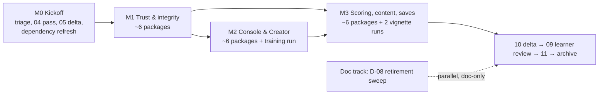

# Release 2.0 Plan

[↑ Feature planning index](INDEX.md) · [Release plan (buckets)](01-release-plan.md) ·
[Release 1.0 manifest](../releases/release-1.0.md) ·
[REV-REL-004](../reviews/release-assessment-release-candidate-10.md) · [Backlog](../pipeline/backlog.md)

> **What this is.** A forward planning proposal for the next release after Release 1.0 (GO 2026-11-01),
> requested by the owner on 2026-11-01. It gathers every candidate item in the tree (backlog, archive,
> the former future-work list, candidate requirements, integration reviews, release assessments, learner and manual
> reviews, strategic review), sorts them, and proposes scope, sequencing, gates and owner decisions.
>
> **What this is not.** It is not a requirements change, a Feature Specification, an Implementation
> Package or a backlog entry. Nothing here is authorized work. Every item still enters the pipeline through
> `00-intake` and `00-pipeline-manager` triage (§7 lists the proposed intake rows), and every package still
> needs MSTR-006 §3 authorization. The `01-release-plan.md` bucket table is unchanged by this document; a
> `05-feature-decomposition` delta pass adds the new bucket once the owner accepts the scope (Decision 1).
>
> **Naming (D1 decided, 2026-11-01).** Releases are named MAJOR.MINOR; the bucket carries the same ID. The old
> "Release 2" tranche label in `01-release-plan.md` **shipped inside Release 1.0**, so the next product release is
> **Release 2.0** and its bucket **R2.0**. Convention and legacy cleanup: section 8.
>
> **Decision status (2026-11-01).** Owner decisions recorded: **D1, D2, D5, D6, D7, D8, D9, D10, D11, D12, D13, D14**.
> **D3 and D4: DECIDED 2026-11-01 (owner accepted the research recommendations)** -- see
> [`06a-release-2-d3-d4-research.md`](06a-release-2-d3-d4-research.md). The plan treats the researched
> recommendations as the working assumption (D3 Must, D4 Should) as accepted decisions.
>
> **File number.** This folder numbers its documents `01`–`05` in sequence; this is `06`.
>
> **Confidence.** Effort sizes (S ≈ one package or less; M ≈ 1–2 packages; L ≈ 3–4; XL ≈ an architecture
> program) and package counts are **estimates made from the findings' text, not from code study**. Where a
> backlog row looked stale, it was spot-checked against the tree (noted "checked"); everything else is as the
> source states it. The source tree read is `origin/main` at `be41705`.

---

## 1. Executive summary

**Recommended theme:** *Release 2.0 finishes what Release 1.0 shipped: every capability reachable from the
console, every score and save trustworthy, and every mechanic exercised by a shipped vignette.*

**Why this theme.** Release 1.0 shipped with ten owner-accepted known deviations (REV-REL-004 §A.7). Read
together they are not missing features but **half-wired seams**:

- five controls exist only over HTTP (gate approve/deny, live ROE change, undo, clock rate, manoeuvre ledger);
- role scoping ships dormant (no vignette declares `roles_needed`, and the Creator cannot save one);
- save-as-scenario drops four kinds of authored rules;
- two vignette objectives mis-score or cannot be reached (Blue availability objectives read MET while jammed;
  `mt-sigint-geolocate` `characterize_emitter` cannot be reached by orders);
- the manual authors found a further cluster of small behaviour defects (`BL-0390`, `BL-0392`): a resume
  resets the clock rate, `/start` works on a draft, junk roles are accepted, a jammed command reads `executed`,
  bulk import after Start returns `[]` with no reason.

A PME learner meets these at the console, not at the API. Several of them damage **trust**: a scorer reading
MET while a link is jammed, or a learner told a jammed command `executed`, learns the wrong lesson. These are
cheap to fix compared with the alternative big themes (coalition play, proliferated constellations, campaign
persistence, per-seat authentication). Those all change the fog-of-war boundary or the session model, need new
research or architecture, and would be built on top of the same half-wired seams. Finishing first makes the
next big theme cheaper and safer.

**Size (estimate).** About **21–25 code packages** (D5 removed one package, D7 added a small one, D8 added three), **4–5 vignette/training runs**, **2 requirements passes**,
**1 documentation-retirement sweep**, in four milestones (M0–M3). Release 1.0 took 94 packages. Release 2.0 is
roughly a fifth of that. Session limits make the per-package fresh verification the real pacing item, not the
coding.

| Tier | Items | What |
|---|---|---|
| **Must** | 28 | Trust, seat, validation and save-integrity bugs (incl. the `save_format` bump); the link-availability metric (D3); the manuals' behaviour findings; test and ledger hygiene the gates need; genuine APP-6 / MIL-STD-2525 symbology and its approach research (F-40, F-43) |
| **Should** | 23 | Console surfaces for the five HTTP-only controls; Creator completeness; SIGINT characterization path; crewed vignettes; save-as-scenario completeness; Red `bus_state` parity; downlink-delivered telemetry; APP-6 / MIL-STD-2525 symbology; build-spec retirement |
| **Could** (stretch) | 11 | Hardening, small fidelity items, owner-deferred questions if decided "yes" |
| **Later / Out** | 21 | Architecture-scale themes (coalition, proliferated, campaign, auth), research-blocked items, low-value asks |
| **Drop / close** | 8 | Stale rows already delivered, verified fixed, or closed by an owner decision (F-08, F-32) |

**Process changes for Release 2.0 (§5).** Integration review **per milestone tranche**, not at the end;
short-lived branches merged to `main` by PR per package (or small batch), not a stack of ~90 branches;
manual-impact and documentation verification inside every package; the dependency check-latest-then-pin step at
M0 and again at the release; the release archive step at the end.

**Owner decisions (§6):** decided -- R2.0 naming (D1), crewed vignettes with the seat-less bypass kept and
`roles_needed` derived by the Creator (D5), configurable measured live-log caps (D6), no cross-release save
compatibility (D7), trunk-based branching (D11), the D8 set (Red `bus_state` parity, downlink-delivered telemetry,
White-only playback, symbology close to the real sets), the retirement sweep (D13). Researched and accepted by the owner
([06a](06a-release-2-d3-d4-research.md)): availability as interval-scored service availability, Must (D3);
the corrected SIGINT option (a') (D4).

---

## 2. Inventory

Every candidate found. Disposition: **IN** (Must or Should), **STRETCH** (Could), **LATER** (not in R2.0, kept
open with a trigger), **DROP** (close: stale, already delivered, or not worth doing). "Tier" gives Must/Should/Could
for IN and STRETCH rows. Dependencies name other rows in this table.

### 2.1 Bugs and behaviour defects

| # | Id / source | Item | Sev | Effort | Depends | Disp. | Tier |
|---|---|---|---|---|---|---|---|
| B-01 | `BL-0390`; REV-REL-004 §A.7 item 6 | Pause/Resume resets a custom clock rate to 1.0 | Medium | S | — | IN | Must |
| B-02 | `BL-0390`; §A.7 items 2, 6 (D-1); D5 | Creator seat/role matrix is not saved; every Creator vignette has `roles_needed: []`. **D5:** the Creator derives `roles_needed` automatically from its seat/role matrix, so authors declare it once | Medium | S–M | — | IN | Must |
| B-03 | `BL-0390` | A saved vignette is invisible in the library unless `user_save_dir` is also listed in `external_vignette_dirs` | Medium | S | — | IN | Must |
| B-04 | `BL-0390`; REV-REL-004 §5 (reproduced: 200) | `/start` succeeds on a Creator draft session | Medium | S | — | IN | Must |
| B-05 | `BL-0390` | `roles/assign` accepts a role id the vignette does not declare | Low–Med | S | — | IN | Must |
| B-06 | `BL-0390`; unreviewed-packages L-5 | `bulk_import` after Start returns 200 `[]` with no reason (`force/tle` returns `ok:false` + reason); no object cap (6,000 accepted) | Low | S | — | IN | Must |
| B-07 | `BL-0390` | A command whose uplink was jammed shows status `executed` (the event says `achieved="jammed"`) | Medium (misleads learner) | S–M | — | IN | Must |
| B-08 | `BL-0390`; `BL-0364` residue | Observer-seat check on some routes reads only the body `cell`, not the query `cell` | Low–Med | S | — | IN | Must |
| B-09 | `BL-0392`; rc7 L-3 | Observer designation accepts any string; `/activity/observer` then 400s and `GET /observer/view` returns an empty 200 | Low | S | — | IN | Must |
| B-10 | rc3 L-1 (carried rc7 L-5) | `/gate/decide`, `/roe/change` answer a non-White seat 200 `not_controller` instead of the uniform 403 | Low | S | — | IN | Must |
| B-11 | rc3 L-5 | `POST /param` accepts an enum value outside its declared `options` | Low | S | — | IN | Must |
| B-12 | `BL-0392` | Swapped `t1`/`t2` on the time-span exports returns a header-only file with no error | Low | S | — | IN | Must |
| B-13 | unreviewed L-4 | `GET /api/vignettes` returns absolute server file paths to every LAN client; external ids not charset-checked at listing | Low | S | — | IN | Must |
| B-14 | `BL-0140` | A malformed per-object owner (`owner: "purple"`) aborts the whole bulk-import batch | Medium | S | — | IN | Must |
| B-15 | `BL-0386`; §5 residual risk; D6 | Live event log has no cap, but load refuses a save with more than 100,000 entries: a long exercise can produce an unloadable save (same class as the fixed `BL-0371` span bug). **D6:** configurable caps (entries and save size on disk) with defaults set from a measurement of replay time and save size at the cap; warn White at 80 %, refuse further advance at the cap; align the loader limit with the live cap | Medium | M | D6 (decided) | IN | Must |
| B-16 | REV-REL-004 R-2; `BL-0367` | Four tests skip on every run (data-dependent fixtures), so their assertions (`FR-6220` row 10, sensor/pass-booking release, operator `success_prob` override) never execute | Low (gate hole) | S | — | IN | Must |
| B-17 | `BL-0386` | `--origin-report` exits 5 (pytest "no tests collected") — scripts treat the report as a failure | Low | S | — | IN | Must |
| B-18 | §A.7 item 6; `BL-0390` | Blue availability objectives (`pnt_avail`, `satcom_avail`) score satellite health, not link availability: MET while jammed | **High for trust** | M | D3 ([06a](06a-release-2-d3-d4-research.md); DECIDED: owner accepted) | IN | Must (D3 researched). 11 objectives in 8 vignettes to re-point |
| B-19 | §A.7 item 6; `BL-0390`; `BL-0150` | `mt-sigint-geolocate`: Blue cannot reach `characterize_emitter` by orders; `passive_rf_fix()` has no caller | Medium | M | D4 (DECIDED: owner accepted) | IN | Should |
| B-20 | owner brief (vignette finding) | `mt-sigint-geolocate` `preserve_constellation` checks only `SIGINT-1`, not the whole constellation | Low | S (cluster the three satellites a few degrees apart: [06a](06a-release-2-d3-d4-research.md)) | B-19 | IN | Should |
| B-21 | rc3 L-4 | A stale-epoch TLE is accepted by `/force/tle` with `ok:true` and no warning | Low | S | F-22 | IN | Should |
| B-22 | unreviewed L-6 | Rewind/undo resets the SSN and order registries: an orphaned staged SSN product and a reused id remain | Low–Med (replay-adjacent) | M | — | IN | Should |
| B-23 | `BL-0139` | OMM `EPOCH` parsed then discarded; elements anchored at the session start epoch | Medium (fidelity) | M | — | IN | Should |
| B-24 | rc3 L-2; REV-REL-004 F-3 | `mt-*` and `training-basics` `estimated_duration_min` contradict their own deadlines | Low | S | — | IN | Should |
| B-25 | unreviewed L-7 | RIC picker offers non-orbital assets and defaults to a ground jammer (404) | Low | S | — | STRETCH | Could |
| B-26 | unreviewed L-8 | A `scripted_manoeuvre` inject writes no ledger entry (invisible in the manoeuvre ledger) | Low | S | F-01c | STRETCH | Could |
| B-27 | rc3 L-3 | `mt-weather-collect`, `nv-isl-relay-debris`: Red's `track_blue` attainable by AI-Red; Blue has no counter to a passive tracker | Low (balance) | M | — | STRETCH | Could |
| B-28 | `BL-0340` | Any pointerdown on a panel header floats it (a click on the Compare summary floats it) | Low | S | — | STRETCH | Could |
| B-29 | `BL-0252` | `yaml.safe_load` without `YAMLError` guard in the built-in id scan — **checked: `content/vignette.py` now guards all four scans** | — | — | — | DROP | verify + close |
| B-30 | `BL-0284`, `BL-0315`, `BL-0233` | Rewind drops injects; force edits lost on resume; template clause — fixed (`IP-1083`, `IP-1101`/`1102`) or amended per REV-REL-004 §5 | — | — | — | DROP | close |
| B-31 | REV-TRN-013 M-1, L-1, L-2 | WCM-6 Compare sentence; `15` §15.3 pronoun; `11` T+26 note — **checked: fixed in the tree** | — | — | — | DROP | close |
| B-32 | D7 (owner, 2026-11-01) | **No cross-release save compatibility:** bump `save_format`; `validate_save` refuses an older save with a clear message naming the format and release; remove the legacy "reload by vignette id" path (`IP-1101`) and its tests. No migration code or migration test | Medium (removes a path) | S | D7 (decided) | IN | Must |

### 2.2 Documentation, ledger and test-hygiene defects

| # | Id / source | Item | Sev | Effort | Depends | Disp. | Tier |
|---|---|---|---|---|---|---|---|
| D-01 | REV-REL-004 §2.5 class B; `BL-0381` | Retag tests that verify a requirement under a sibling id: `FR-7240`, `FR-6230`, `FR-1140`, `FR-3410`, `FR-7110`, `FR-7350`, `NFR-2400`, `NFR-2500`, `NFR-2600`, `NFR-2800`, `NFR-3200` (11) | Low | S | — | IN | Must |
| D-02 | REV-REL-004 §2.5 class C (open since REV-REL-002) | Origin report should exclude requirements verified by inspection/demonstration/analysis (21 leaves read `UNASSIGNED` today) | Low | S | `04` pass | IN | Should |
| D-03 | `doc_integrity_allow_links.txt` (40 lines, 38 research-primer targets) | Broken research-primer links tolerated on the allow-list | Low | M | — | IN | Should |
| D-04 | `BL-0380`; N7 | Starlette 1.10 `StarletteDeprecationWarning` for `httpx` in `starlette.testclient` | Low | S | dependency refresh | IN | Must (at refresh) |
| D-05 | `BL-0380` | Python floor `>=3.11` but everything validated on 3.13 only | Low | S | D12 | IN | Should |
| D-06 | backlog bookkeeping (counted) | Live backlog holds 71 `DONE`/`DEDUPED` rows not moved to the archive; stale open rows `BL-0049`, `BL-0292`, `BL-0310` (delivered), plus B-29/B-30 rows | Low | S | — | IN | Must (M0) |
| D-07 | `BL-0301`; `BL-0358`/`0376` residue | `CLAUDE.md` "Authoritative source" still calls GDS-06–10 scaffold-only (all five are authored, gates closed) and names build-spec counterparts | Low | S | — | IN | Must |
| D-08 | `BL-0287`, `BL-0292` exit chain, `BL-0293`, `BL-0296`, `BL-0288`, `BL-0291`, `BL-0294`, `BL-0274` | **Retirement sweep:** delete the earlier `IMP-xxxA` package folder (done 2026-11-10); migrate the 6 `spacesim/` files citing build-spec and the §10 phase plan, then delete `docs/build-spec/`; merge DOM files into the GDS ladder and retire; migrate then retire the former future-work list (the root decision log was retired 2026-11-10); fix contradicting wording; drop `docs/scenarios/` references; give the ICD an owner | Medium (confusion, not product) | L (doc churn) | D-07, retired-documents register | IN | Should (D13 decided yes; the owner calls the cleanup important: **promote to Must if capacity allows**) |
| D-09 | `BL-0393`; rc7 L-4 | `NFR-3810` retired-document check has nothing to check on the real tree | Low | — | D-08 (makes it live) | IN | Should (via D-08) |
| D-10 | `BL-0149`, `0169`, `0199`, `0203`, `0242`, `0337`, `0349`, `0359`, `0385`; V-1 (`VR-1088` header) | Ledger/header/back-reference drift and stale counts across packages, specs, `ROADMAP.md`, `training/08` | Low | S | — | IN | Must (one batch) |
| D-11 | `BL-0334`, `0335`, `0336` | Link allow-list keyed on (file, target) hides repeats; sub-index rule unstated in FS-135 | Low–Med | S | — | IN | Should |
| D-12 | `BL-0279`, `0330`, `0338`, `0383`, `0328` | Test hardening notes (training-source gate substring match, watchdog threshold, browser waits, module-level tag over-claim) | Low | M | — | STRETCH | Could |
| D-13 | `BL-0275` | `FR-1480` missing from `FEAT-1400` Included Requirements | Low | S | `05` delta | IN | Must (rides the `05` delta) |
| D-14 | `BL-0257`, `BL-0269` | Owed independent training reviews of runs #157/#164 scope | Low | S | — | DROP | verify superseded by REV-TRN-012/013, then close |
| D-15 | `BL-0028`, `0087`, `0103`, `0280` | Research citations checked by search excerpt only (egress blocked) | Low–Med | M | an environment with fetch | LATER | — |
| D-16 | `BL-0054`, `BL-0057` | Research gaps on bus/payload parameter values | Low | M | — | LATER | — |

### 2.3 Features and capability gaps

| # | Id / source | Item | Value | Effort | Depends | Disp. | Tier |
|---|---|---|---|---|---|---|---|
| F-01 | `BL-0389`; §A.7 item 5; rc3 M-4; unreviewed M-5; FS-125, FS-127 | **Console surfaces for the HTTP-only controls:** (a) gate approve/deny queue (`FR-3430`); (b) live ROE change (`FR-3440`); (c) manoeuvre ledger view + CSV (`FR-1320`); (d) undo; (e) clock-rate control | High | L (3 pkgs) | B-01, B-10 | IN | Should |
| F-02 | §A.7; `BL-0390`; FS-117 | **Creator completeness:** save the role matrix (B-02), human-readable validation messages instead of raw JSON, pre-validate before save, show saved vignettes (B-03) | High | M (2 pkgs) | B-02, B-03 | IN | Should |
| F-03 | §A.7 item 6 | **Link-availability objective metric:** interval-scored service availability at the user end, honouring `is_link_denied`, replacing health-based `pnt_avail`/`satcom_avail` (11 objectives, 8 vignettes; [06a](06a-release-2-d3-d4-research.md)) | High (trust) | M + 1–2 vignette runs | D3 (DECIDED: owner accepted), `04` | IN | Must (D3 researched) |
| F-04 | `BL-0150`; `FR-1650` | **SIGINT characterization path, option (a') ([06a](06a-release-2-d3-d4-research.md)):** extend `passive_rf_fix()` to the ground-emitter case (space receivers); add an emitter on/off state (+ EMCON inject); "characterized" needs the emitter on, ≥3 simultaneous satellites and fix error ≤ the objective's limit; `observe` order with `intent="characterize"` | Medium–High | M–L (slightly larger than first sized) | D4 (DECIDED: owner accepted) | IN | Should |
| F-05 | §A.7 item 2 (D-1 / O-2); D5 | **Crewed vignettes (D5: at least two):** shipped vignettes declare `roles_needed` (authored once through the Creator matrix, B-02/F-02), with briefs, tutorials, playbook entries and a learning-path rung. The seat-less hot-seat path is unchanged | High (makes FEAT-3500 live) | M (vignette runs) | F-02, B-02 | IN | Should |
| F-06 | `BL-0389`; §A.7 item 4; unreviewed M-4 | **Save-as-scenario completeness:** carry `effect_gating_rules`, `effect_detectability_config`, `space_weather_series` + environmental-anomaly rate, and the inject schedule | High | M (1–2 pkgs) | B-32 | IN | Should |
| F-07 | unreviewed L-9 | **Mechanics coverage in content:** no shipped vignette uses `roe:`, `effect_gating_rules`, `effect_detectability_config`, `space_weather_series`, `environmental_anomalies` | Medium–High | M (vignette run) | F-01, F-06 | IN | Should |
| F-08 | `BL-0388`; `FR-3520` amended | Close the seat-less bypass. **Closed by D5:** the bypass is kept (no mandatory seat requirement); the `BL-0388` behaviour is recorded as intended and `FR-3520`'s amendment note kept | — | — | D5 (decided) | DROP | close with a note |
| F-09 | `BL-0181`, `BL-0393`; `FR-7450` | Telemetry **series** route still integer-microsecond only (exports got ISO bounds via `IP-1089`); console never shows µs | Low–Med | S | — | IN | Should |
| F-10 | CR-29, CR-30, CR-32, CR-33, CR-35; `BL-0342`/`0345`/`0348`/`0369` | Built behaviour with no requirement leaf (countermeasure modifiers, bus view levels, scene orbital elements, SIGINT error scaling, space-weather names) — baseline it or record "implementation detail" | Low | S (`04` only) | — | IN | Should |
| F-11 | `BL-0316` | Failure modes for a malformed save session portion are not enumerated (most are now refused by `IP-1103`) | Low | S | `04` | IN | Should |
| F-12 | `BL-0171`; CR-34; `BL-0382`; D8(b) | **Downlink-delivered telemetry visibility:** a cell sees all telemetry it has downlinked, i.e. everything up to its last ground-station pass. Pass-gated (`FR-2310`) and defined as "delivered by a downlink", not a time-only gate. **Acceptance:** the telemetry CSV export (`FR-2320`) honours the same rule (no row past the last delivered downlink); the series route and graphs likewise | Medium | S–M | D8 (decided) | IN | Should |
| F-13 | `BL-0187`; D8(a) | **Red `bus_state` parity:** author `bus_state` for every shipped Red satellite so Red's SOH / safe-mode experience matches Blue's. **Acceptance:** a parity test asserts every Red satellite in every shipped vignette has the bus/payload SOH, limits, safe-mode entry and the recovery chain that its Blue counterpart has | Medium | M (vignette runs) | D8 (decided) | IN | Should |
| F-14 | `FR-6610`; `BL-0015`; §A.7 item 7 | Automatic hot-seat hand-off (screen blank between seats) | Medium (fog in hot-seat) | S–M | — | STRETCH | Could |
| F-15 | FS-108 *(candidate, not authorized)*; R18 | Inject authoring UX (templated preview) | Medium | M | — | STRETCH | Could |
| F-16 | `BL-0154` | CATS readout illumination banding | Low | S | — | STRETCH | Could |
| F-17 | CR-23, CR-24 | TLE checksum/epoch sanity at load; load-time integrity of other in-vignette cross-references | Medium | S–M | `04` | STRETCH | Could |
| F-18 | CR-25, CR-26 | Range rules for order parameters; unreadable external vignette directory disclosed | Low | S | `04` | STRETCH | Could |
| F-19 | CNFR-07; R19 | Document the distributed-use security growth path (threat model, token design sketch) — design document only, no build | Medium | S (doc) | D9 | STRETCH | Could |
| F-20 | `BL-0080`; CR-13; R14; former future-work list §9 | Coalition / multi-partner play (N-cell, releasability, per-nation ROE) | High (external demand) | XL | `03`, D10 | LATER | — |
| F-21 | CR-02; LAN trust model (§A.7 item 10) | Per-connection authentication / per-cell tokens | High for non-LAN use | L | F-19, D9 | LATER | — |
| F-22 | CR-01; CNFR-06; ADR-0024; §A.7 item 8 | AI-Red fog-of-war parity | Medium–High | L | — | LATER | — |
| F-23 | CR-12; R13; former future-work list §4 | Proliferated constellations + aggregation UI | High | XL | research | LATER | — |
| F-24 | CR-15; R15 | Campaign container + time compression | High | XL | `03` | LATER | — |
| F-25 | CR-14; R11; former future-work list §7 | Commercial SDA feed / gray actors | Medium | L | — | LATER | — |
| F-26 | CR-17; R16 | Persistent debris + wire `prop.collision_avoid` to conjunction screening | Medium | L | — | LATER | — |
| F-27 | CR-16; R17 | Ground-segment-as-terrain cyber | Medium | L | research | LATER | — |
| F-28 | CR-18 | Cross-session adjudication-consistency support | Low–Med | M | — | LATER | — |
| F-29 | R10 | Counterfactual AAR + belief-vs-truth analytics (partly exists: branch compare, `assessment.py`) | Medium–High | M–L | — | LATER | — |
| F-30 | FS-202 *(candidate)* | Rubric authoring for FS-201 | Low–Med | M | — | LATER | — |
| F-31 | `BL-0303`; CR-21 | Longitudinal per-trainee reporting (needs identity + ethics boundary) | Low now | L | CR-21 | LATER | — |
| F-32 | `BL-0382`; D8(c) | Per-seat playback cursors. **Closed by design (D8):** playback is controlled solely by White; cells analyse history through the telemetry export (F-12 acceptance criterion) | — | — | D8 (decided) | DROP | close with a note |
| F-33 | `BL-0382`; D8(d) | Configurable 366-day span. Kept as a sensible limit and **recorded as a design choice, not a user requirement**; closed as-is. Fold into the D6 configurable caps only if cheap | Low | S | D8 (decided), D6 | LATER | — |
| F-34 | `BL-0308` | HTTP API versioning | Low (no second client) | S | trigger | LATER | — |
| F-35 | `BL-0215` | Fence radar "detects more objects" acceptance wording | Low | S | `04` | LATER | — |
| F-36 | `BL-0281`; CR-27 | Environmental anomaly semantics; repeatable condition-inject re-fire rule | Low | S | `04` | LATER | — |
| F-37 | CR-03 … CR-11 | Push delivery, command-relationship layering, sustained degradation, observer reassignment, AI-Red preset guidance, save cross-version compatibility (CR-08: **closed by D7**, no compatibility promised), PlannedActivity supertype, AccessWindow persistence, partial authoring-state ownership | mixed | mixed | — | LATER | — |
| F-38 | former future-work list §2; R12, R20–R22, R24 | High-fidelity propagator; environment term; human-AI teaming lab; AI-vs-AI; cislunar; training-transfer study | mixed | XL | research | LATER | — |
| F-39 | `BL-0370` | `build_world` mutates its input vignette | Low | S | trigger | LATER | — |
| F-40 | `BL-0306`; D8(e) | **Genuine APP-6 / MIL-STD-2525 symbology** as close as possible to the real symbol sets, visually recognizable as the same to a user: affiliation frames and space-domain icons on the 2D map and the 3D globe. Replaces the "APP-6-adapted" convention. **Acceptance:** side-by-side recognizability check against the published sets for every affiliation and each space-domain icon used by a shipped vignette | Medium | M–L | F-43, D8 (decided) | IN | Must |
| F-43 | D8(e) | **Symbology approach research:** choose between an open-source renderer (e.g. `milsymbol`, check its license) and an own SVG set; license / IP check for the symbol artwork and the standards' text; define the visual-recognizability acceptance criteria | — | S–M (research) | `02-research-*` | IN | Must |
| F-41 | R8 | Headless Monte Carlo harness — delivered as `spacesim/tools/research_batch.py` (`IP-3010`) | — | — | — | DROP | close the former future-work list line in D-08 |
| F-42 | former future-work list §8 | Browser-GUI verification harness — delivered (`IP-1340`, 42 browser tests) | — | — | — | DROP | close in D-08 |

Totals: 32 bug rows, 16 documentation rows, 43 feature rows (91). **Must 28** (B-01–B-18, B-32, D-01, D-04, D-06,
D-07, D-10, D-13, F-03, F-40, F-43). **Should 23** (B-19–B-24, D-02, D-03, D-05, D-08, D-09, D-11, F-01, F-02, F-04–F-07, F-09–F-13, ). **Could 11**
(B-25–B-28, D-12, F-14–F-19). **Later 21**. **Drop 8** (B-29–B-31, D-14, F-08, F-32, F-41, F-42). Each row counted once; F-01 alone is five console surfaces and D-08 is a whole sweep.

---

## 3. Recommended scope

### 3.1 Must — trust, seats, validation, save integrity, and gate hygiene

Ship-blocking for R2.0. Each one either misleads a learner or scorer, accepts input it should refuse, or leaves
a hole in a gate the release relies on.

- **Seat and fog rules uniform:** B-08, B-09, B-10, B-13 (and B-04: a draft cannot be started).
- **Validation that refuses with a reason:** B-05, B-06, B-11, B-12, B-14.
- **Session and save integrity:** B-01 (resume keeps the rate), B-15 (measured, configurable caps; live log cannot outgrow what load accepts), B-32 (`save_format` bump; old saves refused),
  B-02/B-03 (a Creator save keeps what the author entered and shows up in the library).
- **Honest status:** B-07 (a jammed command reads `jammed`, not `executed`); B-18 + F-03 (D3: an availability objective is not MET while the link is jammed).
- **Gate hygiene:** B-16 (no always-skipped test), B-17, D-01 (retags), D-04 (dependency refresh), D-06, D-07,
  D-10, D-13.

### 3.2 Should — finish the half-wired features

- **F-01** console surfaces for gate approve/deny, ROE change, manoeuvre ledger, undo, clock rate.
- **F-02** Creator completeness (role matrix saved, readable validation messages, pre-save validation).
- **F-04 + B-19 + B-20** SIGINT characterization path and the `mt-sigint-geolocate` objectives (corrected option (a'), D4: DECIDED: owner accepted).
- **F-05** at least two crewed vignettes that exercise role scoping (seat-less hot-seat bypass kept, D5; F-08 closed).
- **F-12, F-13** downlink-delivered telemetry visibility and Red `bus_state` parity (D8).
- **F-40 + F-43** genuine APP-6 / MIL-STD-2525 symbology and its approach research (D8).
- **F-06** save-as-scenario completeness; **F-07** vignettes that exercise the R1 mechanics.
- **F-09, F-10, F-11, D-02** small requirement/route gaps; **B-21–B-24** small fidelity and content items.
- **D-03, D-05, D-08 (+D-09), D-11** documentation: allow-list burn-down and the retirement sweep.

### 3.3 Could — stretch, in this order if capacity remains

F-14 (hot-seat hand-off), F-17, F-15 (FS-108), B-25, B-26, B-27, B-28, D-12,
F-16, F-18, F-19.

### 3.4 Out of scope for R2.0, with reasons

| Item | Reason |
|---|---|
| Coalition / multi-partner (F-20) | Changes the fog-of-war boundary model (cell → partner); needs `03` architecture first; XL. Recommend a `03` design study in R2.0 only if D10 says so |
| Per-cell authentication (F-21) | The product is trusted-LAN only by design; building auth before the threat model (F-19) is premature |
| AI-Red fog parity (F-22) | A documented design boundary (ADR-0024); large; pedagogy value real but not a trust defect |
| Proliferated, campaign, commercial, debris, ground-segment cyber (F-23–F-27) | Each needs research and/or architecture; each is its own release theme |
| Research-blocked items (D-15, D-16, F-38) | Need an environment with unrestricted fetch, or a research commission |
| Low-value or trigger-gated asks (F-28–F-37, F-39) | No user demand on record; trigger has not fired |
| Per-seat playback cursors (F-32) | Closed by design (D8): White alone controls playback |

---

## 4. Sequencing

Four milestones. Each ends with an **integration review of that tranche** (§5) before the next starts writing
code that depends on it. Entry stages follow `00-intake`'s table: a code bug enters at `07` (remediation package);
a capability already in the baseline enters at `06` (or `07` if its spec already covers it); a capability with no
requirement enters at `04`; a doc defect goes to the owning skill.

### M0 — Kickoff (no product code)

| Step | Items | Stage |
|---|---|---|
| Symbology approach research (F-43): renderer choice, license / IP check | F-43 | `02-research-*` |
| Backlog triage + archive of the 71 closed rows; close stale rows | D-06, B-29, B-30, B-31, D-14, F-41, F-42 | `00-pipeline-manager` |
| File the §7 intake rows | all IN rows not already one row each | `00-intake` |
| Owner decisions D1–D12 | §6 | owner |
| One requirements pass | F-03 (link-availability leaf, after D3 research), B-15/D6 (configurable caps and the 80 % warn / refuse rule; the default figures come from the measurement, not the pass), B-32/D7 (`save_format` refusal), B-02/D5 (`roles_needed` derivation), F-09, F-10, F-11, D-02, D-13 note | `04-requirements-engineering` |
| `05` delta: add the R2.0 bucket, bucket each IN Feature | this plan, D-13 | `05-feature-decomposition` |
| Dependency check-latest-then-pin dry run (fix N7 early) | D-04, D-05 | `08-code-implementation` (one package) |
| `CLAUDE.md` currency | D-07 | `08-code-implementation` doc step |

Size: 0 product packages, 1 tooling package, one `04` pass, one `05` delta. Cost risk: low. Owner time is the
pacing item.

### M1 — Trust and integrity (Must)

| Package (proposed grouping) | Items | Entry |
|---|---|---|
| P1 Session-control refusals | B-01, B-04, B-10, B-11 | `07` |
| P2 Seat/observer uniformity + listing leak | B-08, B-09, B-13 | `07` |
| P3 Authoring/import validation | B-05, B-06, B-12, B-14 | `07` |
| P4 Honest jammed status | B-07 | `07` |
| P5 Live event-log cap | B-15: measure replay time and save size at the cap on reference hardware, set the defaults from that measurement, warn at 80 %, refuse at the cap, align the loader limit with the live cap | `07` after the `04` leaf |
| P5a `save_format` bump | B-32: refuse old saves with a clear message, remove the legacy by-id path and its tests | `07` after the `04` leaf |
| P6 Test and ledger hygiene | B-16, B-17, D-01, D-10 | `07` (tag/fixture only) |

Size: ~7 packages, all S except P5 (M). Parallelism: P1–P4 touch different routes and can run in parallel branches; P5 and P5a touch
`SessionManager` save/advance paths, so serialize them after P1 (P5a before P5, since both change the save). P6 last (it retags tests the others may add).
**Integration review tranche 1** on the merged result (seat sweep, refusal codes, replay equality).

### M2 — Console and Creator completeness (Should)

| Package | Items | Entry |
|---|---|---|
| P7 Gate-approval queue + ROE change panel (White) | F-01a, F-01b | `07` (FS-127 already names the console half) |
| P8 Toolbar: undo + clock-rate control | F-01d, F-01e | `06` (no spec covers these surfaces) |
| P9 Manoeuvre ledger view | F-01c | `07` (FS-125) |
| P10 Creator: role matrix saved (`roles_needed` derived automatically from the seat/role matrix) + saved vignettes visible | B-02, B-03 | `07` |
| P11 Creator: readable validation, pre-save validation | F-02 | `06` (FS-117 revision) |
| P12 Series route ISO bounds | F-09 | `07` after `04` |

Size: ~6 packages (M each for P7, P11). Heavy **manual impact** (WCM sections, `12c`/`12d` "HTTP only" lines,
`10b` UI reference, §15.1 rows): schedule an `08-training-manual-authoring` run inside the milestone, not after
it. Parallelism: P7/P9 and P10/P11 are independent pairs; P8 shares the toolbar with P1's rate fix (after M1).
**Integration review tranche 2.**

### M3 — Scoring, content and saves (Should), then release

| Package / run | Items | Entry |
|---|---|---|
| P13 Link-availability metric | F-03, B-18 | `06` (after the `04` leaf) |
| P14 SIGINT characterization path | F-04, B-19 | `06` |
| P19 Downlink-delivered telemetry visibility (series, graphs, CSV export; F-12 acceptance) | F-12 | `04` then `07` |
| P20 Genuine APP-6 / MIL-STD-2525 symbols on 2D map and 3D globe (after the F-43 research) | F-40 | `06` |
| P15 Save-as-scenario completeness | F-06 | `07` (FR-5510 covers it; builds on the P5a `save_format`) |
| P16–P17 Fidelity small items | B-21, B-22, B-23 | `07` |
| V1 Crewed vignettes (≥2) | F-05 | `08-vignette-development` |
| V2 Mechanics vignettes + `mt-*` fixes | F-07, B-20, B-24 | `08-vignette-development` |
| V3 Red `bus_state` for all shipped Red satellites + parity test | F-13 | `08-vignette-development` |

Size: ~7 packages + 3 vignette runs (the D5 role-gate package is gone: the Creator derives `roles_needed`, the seat-less bypass stays). V1/V2 depend on P13–P15. **Integration review tranche 3**, then the release
close: a final `10` delta over the whole R2.0 set (small, because tranches 1–3 were reviewed), a current
`09-training-manual-review` learner walkthrough, the release-time dependency refresh, `11-release-readiness`, and
the archive step.

### Documentation track (parallel, doc-only)

D-08 (retirement sweep) with D-09, D-03, D-11. It touches no `spacesim/` behaviour except comment citations in six
files, so it can run on its own short branch from M0 onward. Merge it **before M3's vignette runs** so the training
peers write against the final doc tree. It makes the `NFR-3810` retired-documents check live for the first time.

### Risk register

| # | Risk | Likelihood | Impact | Mitigation |
|---|---|---|---|---|
| R1 | **Determinism:** P5 (log cap), P5a/P15 (save format and content), B-22 (SSN registry on rewind) and P13 (metric reads denial state) touch replay paths | Medium | High | Determinism test stays a permanent gate; add replay-equals-live checks at the tranche review for every touched path (as the unreviewed-packages review did) |
| R2 | **Fog of war:** F-01 adds White panels; F-03 metric and F-04 track delivery could leak truth into a cell view | Medium | High | Browser fog tests (`IP-1340`) extended per surface; seat sweep in every tranche review; F-04 delivers only into the requester's `TrackCatalog` |
| R3 | **Save/replay integrity:** P15, P5 and P5a change what a save holds | Medium | High | D7: no cross-release compatibility, so no migration code or test; a bumped `save_format` makes `validate_save` refuse any older save before replay with a clear message; replay-equals-live checks on the new format |
| R4 | **Vignette scoring change** (F-03) changes outcomes of shipped vignettes and their playbooks | High | Medium | Update `test_vignette_tutorials.py` expectations in the same package; manual-impact rows for `11`/`16` |
| R5 | **Doc/training debt:** M2 changes many manual sections at once | High | Medium | Manual-impact inside each package (DoD); a training run inside M2; learner walkthrough before `11` |
| R6 | **Retirement sweep breaks links** across the tree | Medium | Low | Doc-integrity suite catches it; one sweep on one branch; retired-documents register entries in the same commit |
| R7 | **Session limits:** fresh-agent verification per package; long reviews overrun a session | High | Medium | Keep packages S/M; one package per branch; tranche reviews scoped to ≤6 packages |
| R8 | **Ledger drift** across parallel branches (Release 1's recurring finding) | High under stacking | Medium | §5 branching strategy; ledger rows edited only in the package's own PR; the ledger-integrity check extended to package headers (`BL-0355`'s suggestion) |
| R9 | **Owner availability:** decisions D3 and D4 (researched, awaiting acceptance) gate M3 | Medium | Medium | Ask all of §6 in one sitting at M0; defaults recommended for each |
| R10 | Effort estimates are guesses from finding text | High | Low–Med | Re-size at `07` planning; drop Could items first |

---

## 5. Branching and change management

*Decided by the owner (D11, 2026-11-01): git best practice, trunk-based development.*

### 5.1 Branching

- **Trunk-based.** `main` is always releasable and green; no long-lived release or integration branch.
- **One short-lived branch per package** (`r2/ip-xxxx-<slug>`, or `r2/doc-<slug>` for doc, pipeline and training
  runs), cut from current `main`, lifetime **<= ~2 days**. A package too big for that is split.
- **No stacked branches.** A branch never builds on another open branch. If two packages share code, merge the
  first before starting the second.
- **Rebase onto (or merge) `main` daily** while a branch is open, so ledger and index conflicts surface early.
- **PR to `main`** after the package's `09` verification passes, with **required checks**: the full test suite
  (determinism and import-guard gates included) and the doc-integrity tests.
- **Squash-merge** so `main` stays linear: one commit per package. **Delete the branch after merge.**
- **Branch protection on `main`:** required checks, PR required, no direct pushes, no force-push, linear history.
- **Commit messages:** conventional-commit style with the package ID, e.g. `fix(session): refuse /start on a draft (IP-1400)`,
  `docs(training): ... (TR-xxx)`; the squash commit keeps that subject. Types: `feat`, `fix`, `docs`, `test`,
  `refactor`, `chore`.
- **Ledgers** (`ROADMAP.md`, Master Build Plan, package header, feature index) change only in the PR that changes
  the status, so a merge carries the status with the work.
- **Tranche reviews** run on `main` at a named commit, tagged `r2.0-m1-review` etc. (lightweight tags).
- **Release tags are annotated** (`release-2.0`) and are created in the release step (`11`), on the release commit
  on `main`, together with the **archive ref** `archive/release-2.0` and the manifest (naming: section 8).
- The release candidate is a commit on `main`; candidate builds are tagged `2.0-rcN`.

### 5.2 Quality gates for Release 2.0

**Gates every package passes (already process rules):**

1. MSTR-006 §3 authorization before `08` starts.
2. Test-first; every test carries `@pytest.mark.verifies(...)`; RTM Test column regenerated in the same commit.
3. **Manual impact named in the package** (`07`) and **documentation verified** (`09`'s Documentation audit): an
   undocumented operator-visible change returns the package.
4. **Fresh-session verification** by `09` for every package — never the implementing session.
5. Full suite green, including the doc-integrity checks and the determinism and import-guard gates.

**Gates per milestone (new emphasis):**

6. **Integration review per tranche** (M1, M2, M3), scoped to that tranche, before the next tranche's dependent
   code starts. Release 1 found its Highs late (the 40 never-reviewed packages, then RC-3 and RC-7 carrying the same
   Mediums for weeks). Reviewing six packages at a time keeps each review inside one session and stops findings
   from compounding.
7. Tranche review findings loop through `07 → 08 → 09` and the review re-runs before the tranche is closed.
8. A `09-training-manual-review` delta at the end of M2 and M3 (not only before `11`).

**Gates at the release:**

9. Dependency **check-latest-then-pin** (`NFR-1510`, `BL-0379`): check latest versions, try them, run the full
   suite, fix or hold back, then pin. Also run it at M0 so the release-time run is small.
10. A current learner-walkthrough review, full §15.1 coverage, green tutorial tests, no open Manual-impact item.
11. `11-release-readiness` GO/NO-GO, then the **archive step** (merge to `main`, annotated tag `release-2.0`, `archive/release-2.0` ref,
    `docs/releases/release-2.0.md`) before any new work.
12. The always-skipped count is zero (B-16) or each skip is justified in the assessment.

**Avoiding Release 1's failure modes**

| Release 1 failure mode | Release 2.0 counter |
|---|---|
| Integration reviews late; 40 packages never reviewed until near release | Tranche review after every milestone (gate 6) |
| ~90 stacked branches; ledger drift between them (repeated "package header says READY" findings, `BL-0355`, `BL-0375`) | Branching strategy in 5.1; ledger edits only in the package's own PR; extend the ledger check to package headers |
| Known deviations accumulated as "documented v1.1" rather than fixed | Must tier is exactly those deviations; a new deviation needs an owner decision on record when it is accepted |
| Behaviour defects found by manual authors after code was verified | Manual impact inside the package; the learner walkthrough per milestone |
| Owner decisions requested late (`BL-0360` merge decision, O-2) | All §6 decisions at M0 |

---

## 6. Decisions needed from the owner

| # | Decision | Options | Recommendation |
|---|---|---|---|
| D1 | Release name and bucket | Naming convention (owner delegated the choice) | **DECIDED 2026-11-01:** releases are MAJOR.MINOR ("Release 1.0", "Release 2.0"); tags/archives `release-X.Y`; plan buckets named by the same ID (`R1.0`, `R2.0`); review documents named `release-X.Y`, not `release-candidate-N`. Legacy cleanup list: section 8 |
| D2 | Theme | (a) finish-and-trust (this plan); (b) a new-capability theme (coalition or proliferated); (c) mix | **DECIDED (owner accepted recommendation):** **(a)**; do (b) as Release 3.0 on cleaner seams |
| D3 | Availability objective | (a) link availability = fraction of the scoring interval with a usable, un-denied link to the asset's users, computed from replayed state; (b) health AND not-denied at the deadline instant; (c) keep health, rename the objective | **DECIDED 2026-11-01 (owner accepted the research recommendation)** ([06a](06a-release-2-d3-d4-research.md)): option (a) as interval-scored service availability, **promoted to Must** (11 objectives, 8 vignettes re-pointed) |
| D4 | SIGINT characterization path | (a) wire `passive_rf_fix()` into a SIGINT observe/geolocate order that delivers a characterized track; (b) make the `sigint.geolocate` bus verb produce the characterized track; (c) change the vignette objective to something reachable | **DECIDED 2026-11-01 (owner accepted the research recommendation)** ([06a](06a-release-2-d3-d4-research.md)): corrected option (a'), stays **Should**, slightly larger: extend `passive_rf_fix()` to the ground-emitter case; add emission on/off state; a characterized track needs the emitter on, ≥3 simultaneous satellites and fix error ≤ the objective's limit; cluster the vignette's satellites a few degrees apart |
| D5 | Role scoping | (a) ≥2 crewed vignettes and require `seat`; (b) crewed vignettes, keep seat-less bypass; (c) keep dormant | **DECIDED 2026-11-01: (b), chosen for authoring and implementation efficiency.** Ship **≥2 crewed vignettes**; **keep the seat-less hot-seat bypass** (no mandatory seat requirement); the Vignette Creator **derives `roles_needed` automatically from its seat/role matrix**, so authors declare it once. Effects: F-08 closed, P16 removed, B-02 widened |
| D6 | Live event-log cap | Fixed 100,000 / raise load limit / configurable | **DECIDED 2026-11-01:** reasonable limits on file size and runtime (the 100,000 figure is not owner-directed and is no longer the rationale). **Configurable caps with sensible defaults chosen from a measured basis** (save-file size on disk, replay runtime); **warn White at 80 %, refuse at the cap**. Plan item (P5): measure replay time and save size at the cap, set defaults from that, and align the loader limit with the live cap |
| D7 | `save_format` policy | Additive + migration test / major bump, refuse old saves | **DECIDED 2026-11-01: no backwards compatibility between releases.** Bump `save_format`; refuse old saves with a clear message; drop the legacy-save-by-id path and any migration test or work (P5a, B-32). Efficiency gain: no migration code, no old-shape fixtures, no dual-format replay tests, and each later save change is a plain format change |
| D8 | Owner-deferred questions | Red `bus_state`; telemetry visibility; per-seat playback; 366-day span; symbology | **DECIDED 2026-11-01.** (a) Red `bus_state`: **yes**, and Red's SOH / safe-mode experience at **parity with Blue** (F-13 to Should, all shipped Red satellites, parity acceptance test). (b) A cell sees all telemetry it has **downlinked**, i.e. everything up to its last ground-station pass: pass-gated, defined as "delivered by a downlink", not a time-only gate (F-12 to Should). (c) Playback is controlled **solely by White**; no per-seat cursors (F-32 closed by design); cells analyse history by exporting the telemetry log, which must honour the same downlink-delivered rule (F-12 acceptance criterion). (d) The 366-day span stays as a sensible limit, **a design choice, not a user requirement** (F-33 closed as-is; folded into the D6 caps only if cheap). (e) Symbology **as close as possible to the real APP-6 / MIL-STD-2525 sets**, visually recognizable as the same (F-40 DROP to Should, plus research item F-43: milsymbol vs own SVG set, license / IP check, recognizability criteria) |
| D9 | LAN trust model in R2.0 | (a) stay trusted-LAN, write the security growth-path document (F-19); (b) build per-cell tokens | **DECIDED (owner accepted recommendation):** **(a)** |
| D10 | Coalition play (`BL-0080`) | (a) out of R2.0; (b) a `03` design study only; (c) build | **DECIDED (owner accepted recommendation):** **(a)**, or (b) if external demand is firm |
| D11 | Branching | Per-package / per-tranche / stacked | **DECIDED 2026-11-01:** trunk-based, short-lived branch per package, PR with required checks, squash-merge, branch protection. Full rules: section 5.1 |
| D12 | Python floor | (a) validate 3.11 and 3.13 at the release; (b) raise the floor to the validated version | **DECIDED (owner accepted recommendation):** **(b)** unless a user needs 3.11 |
| D13 | Retirement sweep in R2.0 | (a) yes, doc track; (b) defer | **DECIDED 2026-11-01: yes.** The owner says the cleanup is important. D-08 stays Should; **promote it to Must if capacity allows** |
| D14 | Candidate specs FS-108 / FS-202 | authorize FS-108 as Could; FS-202 later | **DECIDED (owner accepted recommendation):** FS-108 **Could**, FS-202 **Later** |

---

## 7. Proposed intake rows

For `00-pipeline-manager` to file through `00-intake` at M0 (IDs assigned at filing; the next free id is
`BL-0394`). Rows that already exist as one backlog row are listed as "update" so they are re-triaged, not duplicated.
`BL-0390` and `BL-0392` are bundles; this table splits them so each can be planned and closed on its own.

| # | Type | Summary | Sev | Entry stage |
|---|---|---|---|---|
| P-01 | bug | Pause/Resume resets a custom clock rate to 1.0 (split from `BL-0390`) | Medium | `07` |
| P-02 | bug | Creator role matrix not saved; `roles_needed` always `[]` (split from `BL-0390`) | Medium | `07` |
| P-03 | bug | Saved vignette invisible unless `user_save_dir` is in `external_vignette_dirs` (split from `BL-0390`) | Medium | `07` |
| P-04 | bug | `/start` succeeds on a Creator draft (split from `BL-0390`) | Medium | `07` |
| P-05 | bug | `roles/assign` accepts an undeclared role (split from `BL-0390`) | Low | `07` |
| P-06 | bug | `bulk_import` after Start returns 200 `[]` with no reason; no object cap (`BL-0390`, unreviewed L-5) | Low | `07` |
| P-07 | bug | Jammed command shows `executed` (split from `BL-0390`) | Medium | `07` |
| P-08 | bug | Observer check reads body `cell` only (split from `BL-0390`) | Low | `07` |
| P-09 | bug | Observer designation unvalidated (split from `BL-0392`; rc7 L-3) | Low | `07` |
| P-10 | bug | Swapped `t1`/`t2` export returns header-only file, no error (split from `BL-0392`) | Low | `07` |
| P-11 | bug | `/gate/decide`, `/roe/change` return 200 `not_controller` instead of 403 (rc3 L-1) | Low | `07` |
| P-12 | bug | `POST /param` accepts an enum value outside `options` (rc3 L-5) | Low | `07` |
| P-13 | bug | `GET /api/vignettes` exposes absolute server paths (unreviewed L-4) | Low | `07` |
| P-14 | bug | Live event log uncapped vs load limit; configurable measured caps, warn 80 %, refuse at cap (D6; split from `BL-0386`) | Medium | `04`, then `07` |
| P-15 | bug | Four tests skip on every run (REV-REL-004 R-2) | Low | `07` |
| P-16 | bug | `--origin-report` exits 5 (split from `BL-0386`) | Low | `07` |
| P-17 | bug | Blue availability objectives score health, not link availability (split from `BL-0390`) | High | `04` |
| P-18 | bug | `mt-sigint-geolocate` `characterize_emitter` unreachable; `preserve_constellation` checks `SIGINT-1` only (update `BL-0150`) | Medium | `06` |
| P-19 | bug | Stale-epoch TLE accepted without a warning (rc3 L-4) | Low | `07` |
| P-20 | bug | SSN/order registries reset on rewind; orphan staged product (unreviewed L-6) | Low | `07` |
| P-21 | bug | `mt-*`/`training-basics` duration vs deadline mismatch (rc3 L-2, REV-REL-004 F-3) | Low | `08-vignette-development` |
| P-22 | feature | Console: gate approve/deny queue + live ROE change (split from `BL-0389`) | Medium | `07` |
| P-23 | feature | Console: undo + clock-rate controls (split from `BL-0389`) | Medium | `06` |
| P-24 | feature | Console: manoeuvre ledger view (split from `BL-0389`) | Medium | `07` |
| P-25 | feature | Creator readable validation messages + pre-save validation (split from `BL-0390`) | Medium | `06` |
| P-26 | feature | Save-as-scenario carries gating rules, detectability, space-weather series, inject schedule (split from `BL-0389`) | Medium | `06` |
| P-27 | feature | Crewed vignettes (≥2) declaring `roles_needed` via the Creator-derived matrix; seat-less bypass kept (D5; update `BL-0388`, close as intended) | Medium | `08-vignette-development` |
| P-28 | feature | Vignettes exercising ROE, gating, detectability, space weather, environmental anomalies (unreviewed L-9) | Medium | `08-vignette-development` |
| P-29 | feature | Telemetry series route ISO-8601 bounds (update `BL-0181`/`BL-0393`) | Low | `04` |
| P-30 | doc-defect | Retag 11 requirements tested under sibling ids (update `BL-0381`) | Low | `07` |
| P-31 | doc-defect | Origin report: exclude non-Test verification methods (REV-REL-004 class C) | Low | `04` |
| P-32 | doc-defect | Burn down the 38 research-primer links on the link allow-list | Low | `02-research-*` owners |
| P-33 | doc-defect | Archive the 71 closed rows in the live backlog; close stale `BL-0049`/`0252`/`0284`/`0292`/`0310`/`0315`/`0233` | Low | `00-pipeline-manager` |
| P-34 | design-question | Branching strategy for Release 2.0 (D11): **decided**, record in backlog as DONE | Medium | `00-pipeline-manager` |
| P-35 | design-question | Release 2.0 theme (D2: decided); name and bucket (D1: decided) | Medium | owner, then `05` |
| P-38 | feature | Downlink-delivered telemetry visibility incl. export (D8b; F-12) | Medium | `04` |
| P-39 | feature | Red `bus_state` parity for all shipped Red satellites (D8a; F-13) | Medium | `08-vignette-development` |
| P-40 | feature | Genuine APP-6 / MIL-STD-2525 symbology; approach research first (D8e; F-40, F-43) | Medium | `02-research-*`, then `06` |
| P-36 | feature | `save_format` bump; refuse old saves; remove legacy by-id path (D7; B-32) | Medium | `04`, then `07` |
| P-37 | doc-defect | Legacy naming cleanup (section 8) | Low | `00-pipeline-manager` |

---

## 8. Naming convention and legacy cleanup

**Convention (D1, owner-delegated, decided 2026-11-01).**

| Thing | Form | Example |
|---|---|---|
| Release | `MAJOR.MINOR` | Release 1.0, Release 2.0 |
| Git tag (annotated) / archive branch | `release-X.Y` / `archive/release-X.Y` | `release-2.0` |
| Candidate build tag | `X.Y-rcN` | `2.0-rc1` |
| Release-plan bucket | `R<X.Y>` | `R1.0`, `R2.0` (plus `Future`) |
| Manifest | `docs/releases/release-X.Y.md` | `release-2.0.md` |
| Review documents | `release-assessment-release-X.Y.md`, `integration-review-release-X.Y-<scope>.md` | not `release-candidate-N` |

Documented in `docs/releases/INDEX.md`.

**Legacy names found and what was done.**

| Legacy name | Where | Action |
|---|---|---|
| Bucket labels "Prototype / MVP / Release 1 / Release 2" | `docs/feature-planning/01-release-plan.md` headings and Feature rationales (about 40 uses) | **Applied:** a naming note added stating they are legacy sub-tranches of R1.0. Headings kept verbatim (the rationales and reviews cite them). The `05` delta adds the new `R2.0` bucket by ID |
| Same bucket list | `docs/feature-planning/INDEX.md` line 15 | **Applied:** reworded |
| Same bucket list | `.claude/skills/05-feature-decomposition/SKILL.md` (assignment step, rule list), `.claude/skills/11-release-readiness/SKILL.md` (opening) | **Applied:** buckets named by release ID, legacy labels noted |
| "Release 1 was declared GO" / "Release 1 — released" | `README.md`, `ROADMAP.md` | **Applied:** now "Release 1.0" |
| `release-assessment-release-candidate-{1,5,10}.md`, `integration-review-release-candidate-1.md`, `integration-review-rc3-delta.md`, `integration-review-rc7.md`, `training-review-final-rc8.md`, `-rc11.md`, `training-review-release-walkthrough*.md` | `docs/reviews/` | **Not renamed** (linked from journals, the manifest, ROADMAP, backlog). Redirect: REV-REL-004 `release-candidate-10` is the Release 1.0 GO assessment; the `rc` numbers are build numbers, not releases. New reviews use the convention |
| Branches `claude/release-candidate-N`, `test-tag-review-1` | git history, `docs/releases/release-1.0.md` | **Not renamed** (history); the manifest already records them |
| "release candidate N" prose | `ROADMAP.md`, `docs/releases/release-1.0.md`, pipeline journal and backlog | **Left** (historical record; renaming would falsify the journal). Follow-up: none |
| Git branching/PR rules | no skill has a git or process section | **Follow-up:** add section 5.1 to `.claude/skills/README.md` (a "Branching and change management" paragraph) and have `08-code-implementation`, `11-release-readiness` cite it; not done now because no existing section fits |

---

*Prepared 2026-11-01 for the owner's Release 2.0 scoping. Sources read: `docs/pipeline/backlog.md` (75 open rows) and
`backlog-archive.md` (closed rows only, by design), the former future-work list, `docs/feature-planning/01`–`05`,
`docs/features/feature-index.md`, the RTM's CR/CNFR rows, `docs/reviews/integration-review-rc3-delta.md`, `-rc7.md`,
`-unreviewed-packages.md`, `release-assessment-release-candidate-10.md` (REV-REL-004 and addendum),
`training-review-final-rc11.md` (REV-TRN-013), `strategic-review-2026-07.md` via former future-work list §13, and
`.claude/skills/README.md`.*
