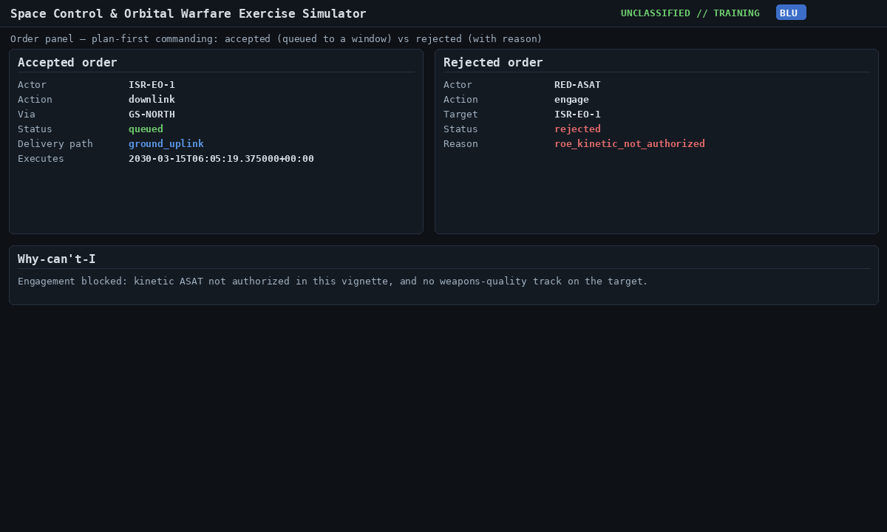
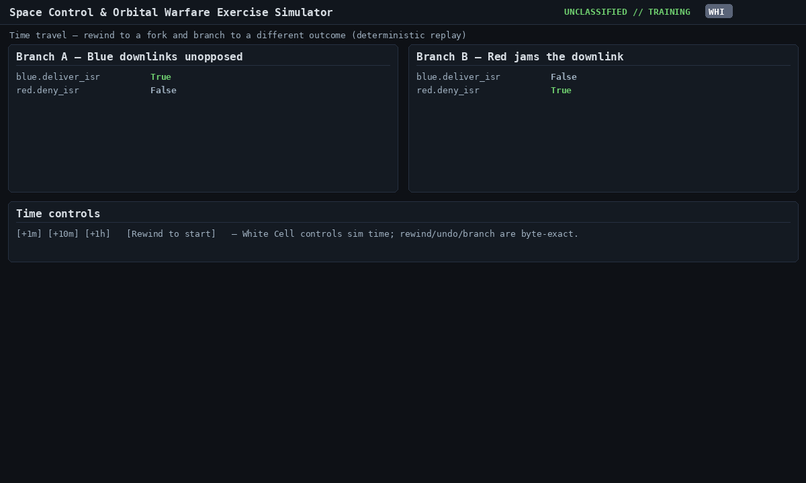

[← Training index](INDEX.md) · [↑ Docs index](../INDEX.md)

## 4. Your first exercise

We'll run **Vignette 1 — LEO ISR Denial**. Blue operates an imaging satellite and must deliver
imagery before a landing window; Red wants to deny it without escalating to a kinetic strike.

### Step 1 — Load and start
1. Open **📋 Session ▾** (top toolbar; it is only there on the **White** seat, which is where you start).
   In the **Vignette** box choose **LEO ISR Denial**, leave **Seed** = 1, click **Load**, then **▶ Start**.
   After Load the line under the toolbar reads `session sess-N`; **▶ Start** was greyed out until then.
   Close the menu (Esc).
2. Look at the **Fleet SOH rollup** panel to confirm the order of battle: Blue's `ISR-EO-1`, ground stations
   `GS-NORTH` and `GS-EAST` and a radar `BLUE-RADAR`; Red's surface group `RED-SURF`, a downlink jammer
   (`JAM-NORTH`) and an (off-by-default) interceptor `RED-ASAT`. As White you see every asset.

### Step 2 — Become Blue and plan a downlink
1. Click **Blue** (the seat buttons at the top). The **Objectives** panel shows `✗ Deliver ISR` — not met yet.
   The **+1m / +10m / +1h** and **⟲ Rewind** buttons disappear: only White controls time.
2. In the **Satellite command** panel (the order form), set **Actor** = `ISR-EO-1` and **Action** = `downlink`. The command
   parameters are in the collapsed **Advanced (raw JSON params)** line below; it is already filled with
   `{"via":"GS-NORTH"}`, which is what we want. Under the form a green line reads `✓ will queue ·
   ground_uplink · window 2030-03-15T06:05:19Z`. Click **Issue order**.
3. The result line shows `queued · ground_uplink · window 2030-03-15T06:05:19Z`: the order is **queued**,
   its **delivery path** is a ground uplink, and it will run at that **window** — you do not act instantly;
   the command waits for the next station pass.



### Step 3 — Advance time to the window
Click **White**, then **+10m** once or twice. When the clock passes the downlink window, the order executes.
Click **Blue** again: **Objectives** now shows `✓ Deliver ISR` — Blue delivered the imagery in time.
**Why one downlink is enough here:** in this vignette the engine counts a successful downlink as delivery;
the satellite is treated as already holding imagery, so no separate collect or observe step is modelled.
(The brief talks about collecting and downlinking as two window problems; later vignettes such as
`mt-isr-sar` do make you collect first.) **Blue wins.**

### Step 4 — Rewind and try the other branch
Because the engine is deterministic, White Cell can **rewind** and explore "what if".

1. As **White**, click **⟲ Rewind**. It goes back to the exercise start (the clock reads 06:00:01Z); delivery is undone and
   the objective is back to `✗ Deliver ISR`.
2. Click **Red**. Set **Actor** = `JAM-NORTH` and **Action** = `jam`. The **Target** dropdown reads *no
   known targets yet — type an id below, or task a sensor to build custody*, because Red holds no track on
   `ISR-EO-1` yet. Type `ISR-EO-1` in the box under the dropdown (its hint reads `type id — untracked ok`).
   Leave the parameters as filled in (`{"modulation":"barrage","power_w":200}`), check for the green
   `✓ will queue` line, and click **Issue order**.
3. Click **Blue** and issue the same downlink as before (**Actor** `ISR-EO-1`, **Action** `downlink`).
4. Click **White** and **+10m** three times (T+30 min). With Seed 1 the downlink is **blocked** — Red jammed it.
   Click **Blue**: **Objectives** still shows `✗ Deliver ISR`, and the **Fleet SOH rollup** panel lists a symptom
   on `ISR-EO-1`: `deny (source unknown)`. Blue can see that something is wrong but cannot yet say who did it.
   A jam is a chance event: another seed can give a different result.
5. **Red's objective is not met yet — that is expected.** Click **Red**: `Deny ISR` still shows `✗`. It is
   judged at the deadline, **T+3 h** (09:00Z): Red has to keep Blue from delivering until then. Meanwhile
   look at the Objectives panel's deadline countdown and at Blue's `✗`. Click **White** and **+1h** three more
   times (T+3 h 30 min), then **Red**: `Deny ISR` now shows `✓`. **Red wins.** (Verified: `✗` at 06:30Z,
   07:30Z and 08:59Z; `✓` once the clock passes 09:00Z.)



That contrast — same start, opposite outcomes depending on play — is the core teaching mechanic.

### Headless walkthrough (no browser)
The same exercise in Python:

```python
from spacesim.session.inprocess import InProcessSession
from spacesim.engine.orders import Order

api = InProcessSession()
sid = api.load_vignette("leo-isr-denial", seed=1)
api.start(sid)

ack = api.issue_order(sid, "blue",
        Order(cell="blue", actor="ISR-EO-1", action="downlink", params={"via": "GS-NORTH"}))
print(ack.status, ack.delivery_path, ack.earliest_window)

start = api.get_godview(sid).now
api.advance_to(sid, start + 800_000_000)          # advance ~13 min past the window
print(api.objectives(sid))                         # blue.deliver_isr -> True
```

---

> **Sources:** `spacesim/ui_web/static/index.html` (`session-menu`, `o-actor`, `o-params`, `rewind`,
> `data-step`) · `spacesim/ui_web/static/app.js` (`loadSession`, `start`, `composeBody`, `previewOrder`,
> `issueOrder`, `setCell`, `rewind`) · `spacesim/session/inprocess.py` (`InProcessSession`) ·
> `spacesim/engine/orders.py` (`OrderSystem`)
