[← Training index](INDEX.md) · [↑ Docs index](../INDEX.md)

## 5. Guided training vignette

The **Training: Basics** scenario (`training-basics`, top of the picker) is a hands-on tutorial
that walks each cell through the core loop. Both sides have a **six-step** sequence below — the
exact actor, action, parameters, *when* to issue, and the expected result. Every step is the real
order the engine executes (these steps are verified by `spacesim/tests/test_training.py`).

**Set up:** pick **Training: Basics**, **Seed = 1**, **Load** → **Start**. The order of battle:
Blue `ISR-EO-1` (LEO imager, modem vulnerability, fuel) with `GS-TRN` ground station and the
`RADAR-TRN` sensor; Red `RED-TGT` (a satellite Blue images), `JAM-TRN` (downlink jammer co-located
with the station), `RED-CYBER`, `RED-RDR`, and `RED-ASAT` (kinetic, off by default).

> In the command panel, **selecting an Actor filters the Action menu to that asset's legal
> actions** and pre-fills the parameter template — see 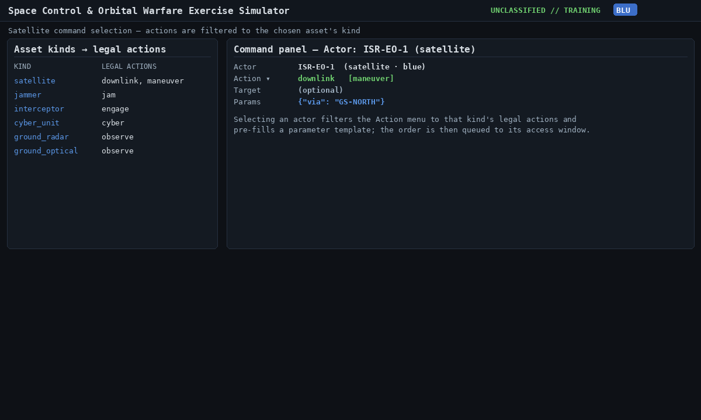
>
> **Setting the Target.** The **Target** dropdown lists only the other side's objects your cell
> already knows about. A target you have not tracked yet, such as `RED-TGT` in Blue Step 2 or
> `ISR-EO-1` in Red Step 2, will not be listed. Type its id in the **or id** box beside the
> dropdown instead; that box wins when both are set. Observing is how a target gets onto the list.
> Details: [UI reference §10.6 row 4](10a-ui-reference-orders.md#106-satellite-command-compose-form).

### Blue — maintain custody and deliver imagery

**Step 1 — Review fleet & objectives.** Click **Blue**. Confirm `ISR-EO-1` is nominal and both
objectives read *pending*.

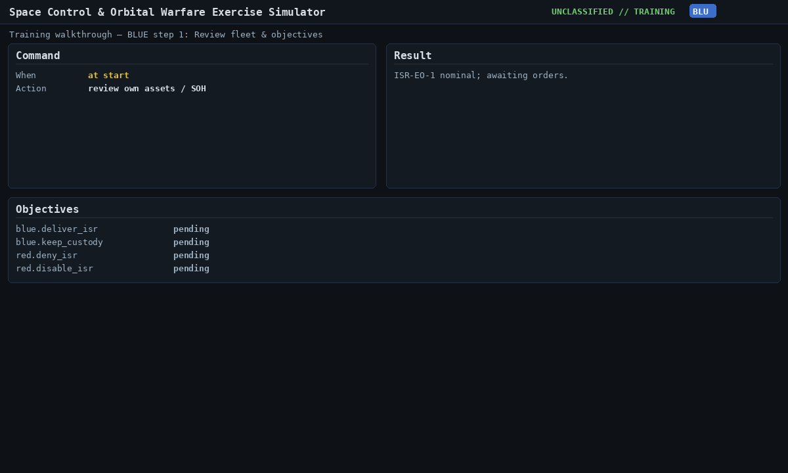

**Step 2 — Task the sensor to build custody.** Actor `RADAR-TRN`, Action `observe`, Target
`RED-TGT`, Params `{"intent":"characterize","classification":"hostile"}`. *When:* issue now; it
collects on RADAR-TRN's early pass. *Result:* a characterized track on RED-TGT — `keep_custody` MET.

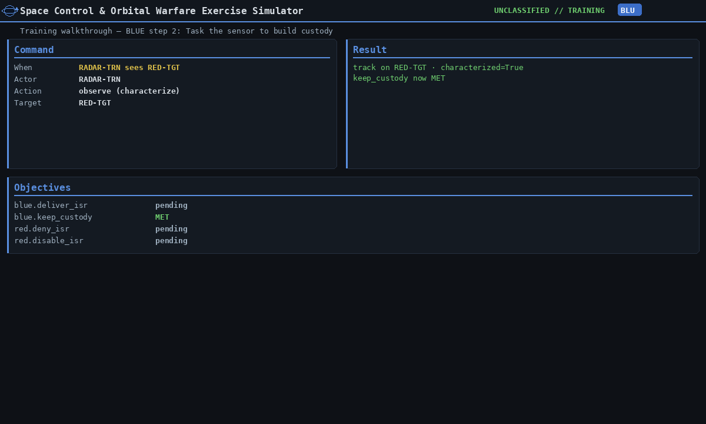

**Step 3 — Plan the imagery downlink.** Actor `ISR-EO-1`, Action `downlink`, Params
`{"via":"GS-TRN"}`. *When:* issue now; it queues to the next `GS-TRN` pass. *Result:* `queued` via
`ground_uplink` with a scheduled execution time.

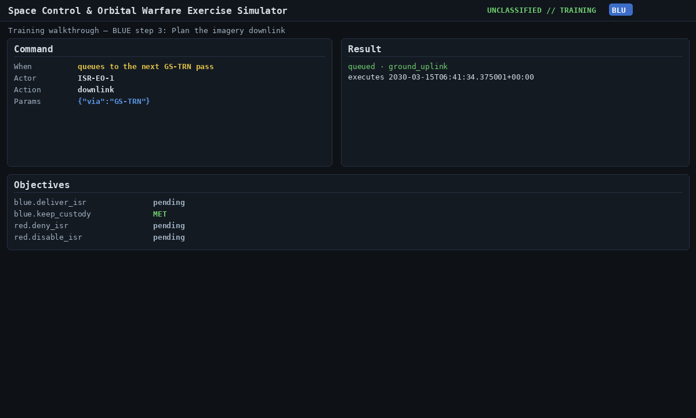

**Step 4 — Advance to the downlink window.** Click **+10m** until the clock passes the window.
*Result:* imagery delivered — `deliver_isr` MET. Stop at or before T+60 min: the next step reads the objectives, and they are live, not latched.

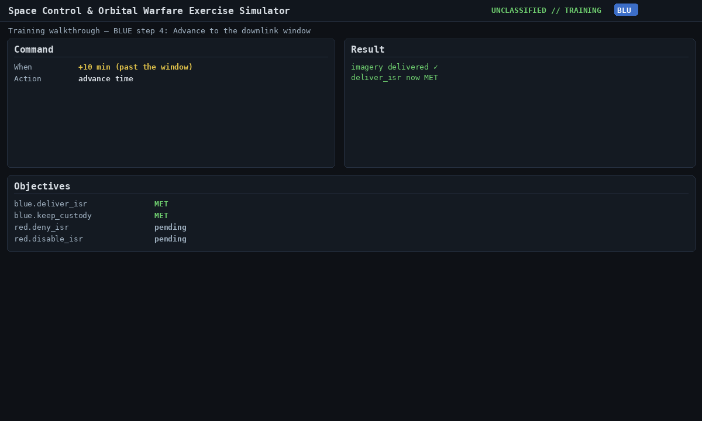

**Step 5 — Confirm both objectives.** At the T+1 h deadline (T+60 min — do **not** click past it), review the objectives panel:
`deliver_isr` and `keep_custody` are both MET — Blue delivered imagery in time and still holds the
track on `RED-TGT`. The panel is live: `keep_custody` is custody confidence decaying in real time, so one more **+10m** click (T+70 min) shows it unmet.

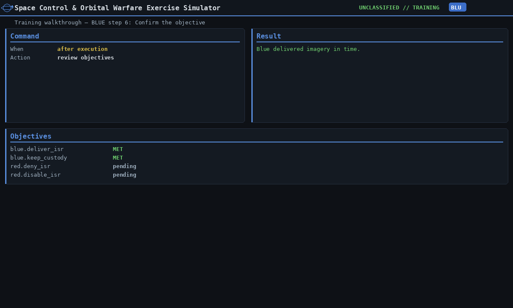

**Step 6 — Maneuver to preserve the orbit (optional, after the exercise).** Actor `ISR-EO-1`,
Action `maneuver`, Params `{"dv":[0,5,0],"via":"GS-TRN"}`. *When:* queues to the next `GS-TRN`
command pass, about T+11 h. *Result:* `queued`; the 5 m/s burn is debited from the fuel budget on
execution. That pass is long after the T+1 h deadline, so it cannot change your score — and by then
`keep_custody` has decayed, which is expected. The point is plan-first: the order waits for its pass.

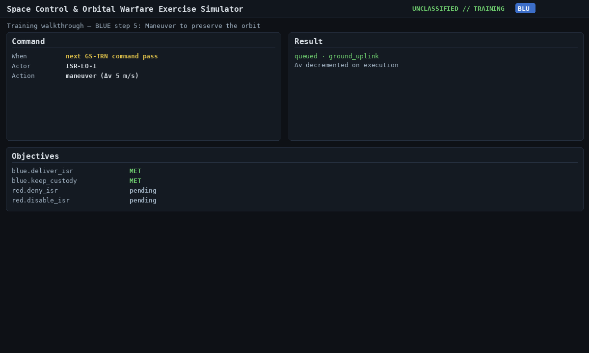

### Red — deny the imagery with reversible effects

Reload **Training: Basics** (or **Rewind**) and click **Red**.

**Step 1 — Review own assets.** Confirm the jammer, cyber unit, radar, and interceptor.

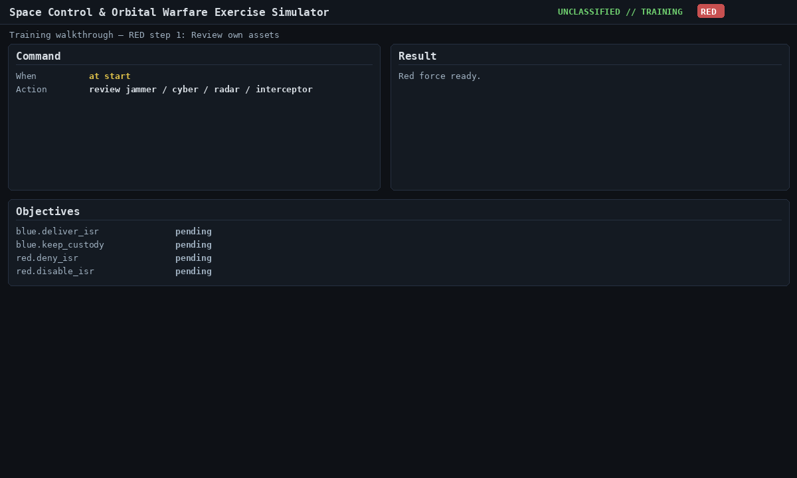

**Step 2 — Find the Blue ISR satellite.** Actor `RED-RDR`, Action `observe`, Target `ISR-EO-1`,
Params `{"intent":"track"}`. *When:* issue now; reports on RED-RDR's early pass. *Result:* custody
on `ISR-EO-1`.

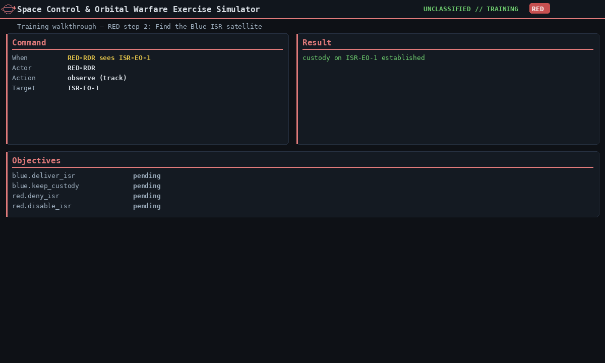

**Step 3 — Jam the downlink.** Actor `JAM-TRN`, Action `jam`, Target `ISR-EO-1`, Params
`{"modulation":"barrage","power_w":200.0}`. *When:* queues to the footprint window over the station.
*Result:* the link is denied during that window — a Blue downlink in this window would fail.

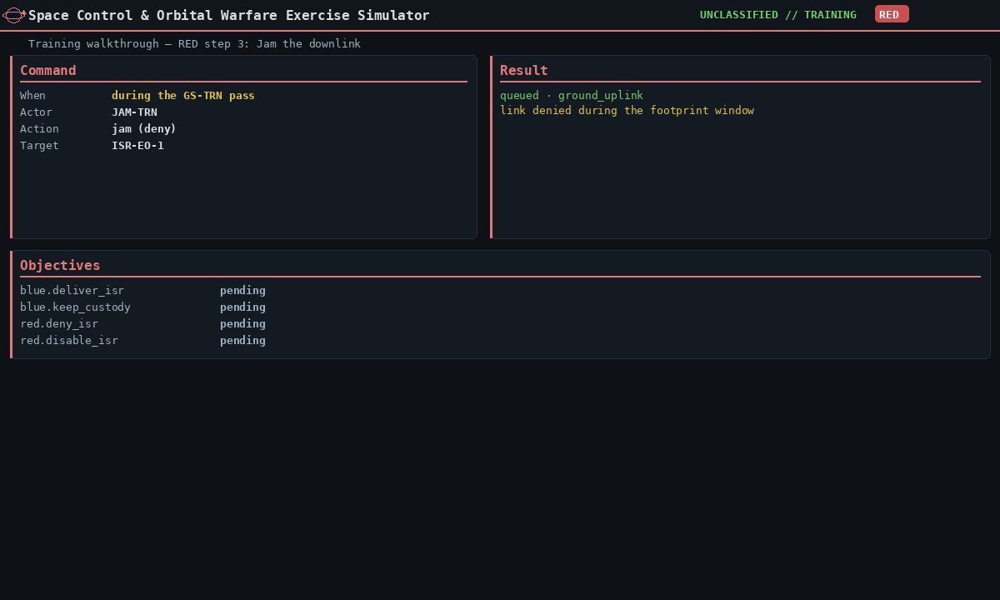

**Step 4 — Cyber the modem (off-pass).** Actor `RED-CYBER`, Action `cyber`, Target `ISR-EO-1`,
Params `{"vector":"ground_modem","payload":"seize_c2"}`. *When:* any time — cyber is **not**
window-gated (and is ON by default: `cyber_authorized = true`). *Result:* a **chance** — about 62%
per attempt against `ISR-EO-1`'s low cyber posture. On success it drops to **safe mode** and
`disable_isr` is MET; on failure nothing happens, so re-issue the order. This is what cyber is
like: the outcome depends on the dice, not just your plan. To see which happened, advance about
1 minute and read the **Objectives** panel: `disable_isr` MET means it worked; still unmet means the
attempt failed (re-issue). The `ISR-EO-1` bus mode reads `safe_mode` only on success.

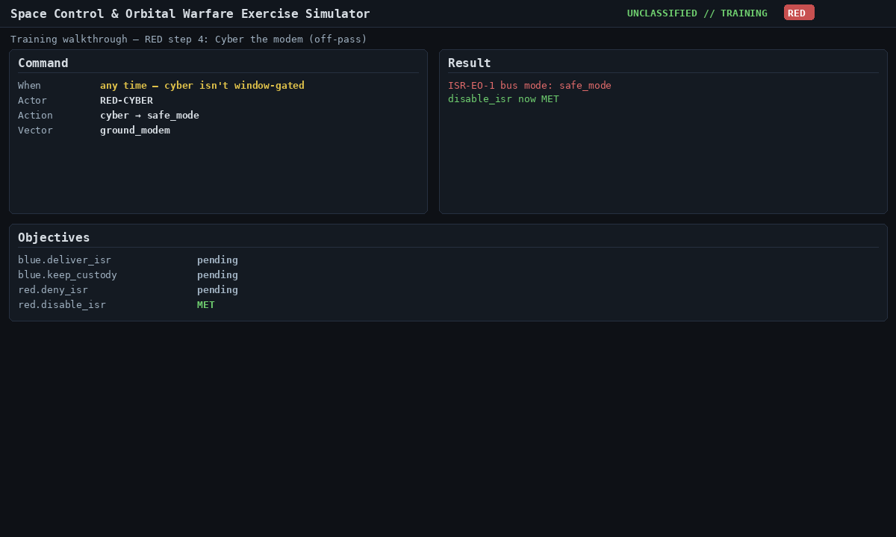

**Step 5 — Advance and assess.** Keep clicking **+10m** until the clock passes T+1 h (3600 s),
past the delivery window. With nothing delivered, `deny_isr` is MET — Red denied the imagery using
only reversible effects.

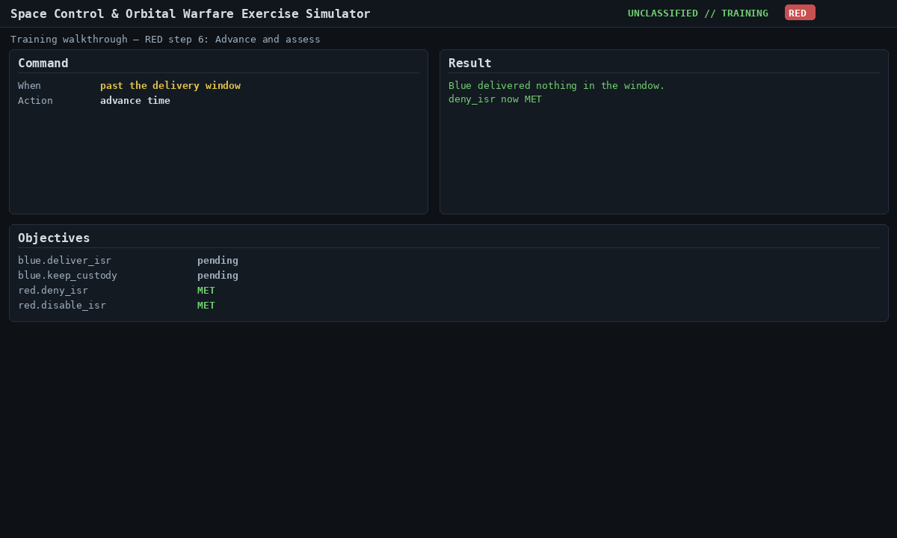

**Step 6 — Attempt a kinetic strike (ROE check).** Actor `RED-ASAT`, Action `engage`, Target
`ISR-EO-1`. *Result:* **REJECTED — `roe_kinetic_not_authorized`.** Kinetic ASAT is off by default;
this teaches escalation restraint (White Cell can enable it with the `red_kinetic_authorized` dial).

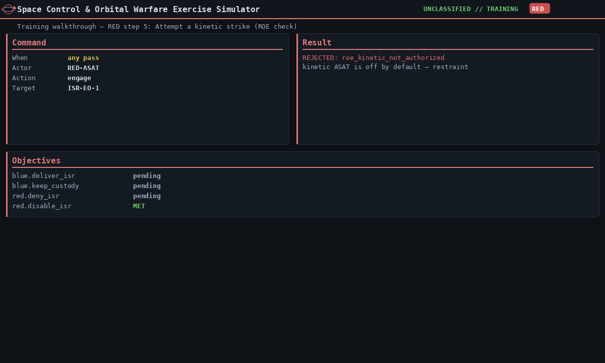

### Blue — recover from the cyber attack

*(This half assumes Red's cyber attempt succeeded. If it failed — `disable_isr` stayed unmet — `ISR-EO-1` is nominal and there is nothing to recover: have Red re-issue the order, or have White Cell fire it, before continuing.)* Red's successful cyber on `ground_modem` flipped `ISR-EO-1` into **safe mode**: the payload is off, the bus
survives, the orbit is unchanged. Reversible effects are only operationally meaningful if the
defender can clear them, so the recovery loop is the second half of the lesson. **Switch back to
Blue** (or reload the session and run Red's steps again as White Cell, then switch) and walk
through the procedure below in order. The order matters: skip the patch and recovery will
re-safe the satellite on the next pass.

**Step 7 — Discover it on the next telemetry contact.** Click **Blue**, then click `ISR-EO-1` in
the fleet rail. The badge turned **red**, the bus mode reads `safe_mode`, and the drill-down
shows the `cdh.faults` log line that flagged the modem. Cyber is **not** window-gated, so the
attack landed when Red issued it — but you only **see** it when the next downlink contact
returns telemetry. The fleet rollup dot turns red as soon as that telemetry lands.

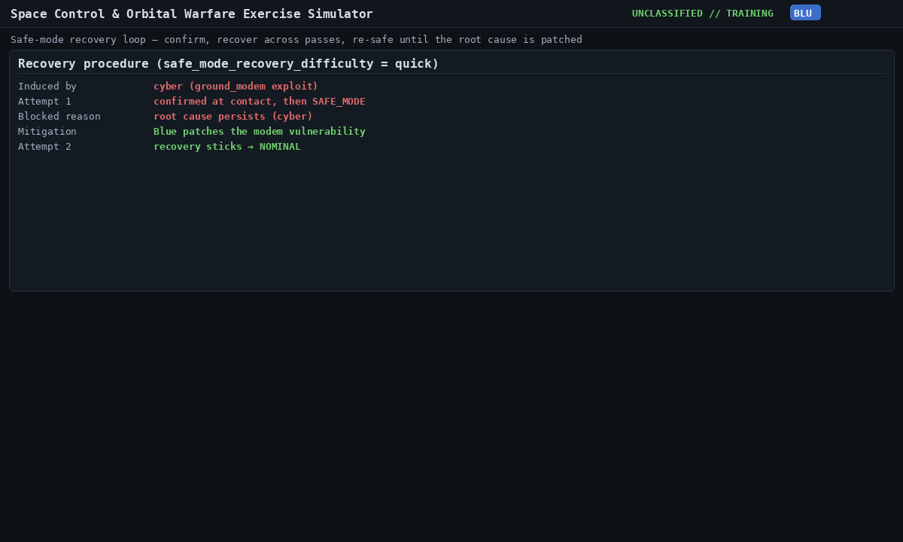

**Step 8 — Patch the vulnerability FIRST.** In the recovery strip, click **Patch (def.patch_cyber)**
(or compose it manually: Actor `ISR-EO-1`, Action `command`, Params
`{"verb":"def.patch_cyber","vector":"ground_modem","via":"GS-TRN"}`). *When:* queues to the next
command-uplink pass and executes there. *Result:* the matching entry in `ISR-EO-1`'s
`cyber_vulnerabilities` flips `patched: true`. **This is the root cause — the cyber attack
exploited an unpatched modem; until you patch it, the access vector is still open and the
attacker's stored access keeps re-safing the satellite.**

> If you skip this step and start recovery first, the engine will mark the asset
> `re-safed: root cause persists (cyber)` after the recovery passes finish — recovery is
> **deterministically** reverted because the vulnerability is still open. The recovery strip
> shows a red warning explaining what to remove before retrying.

**Step 9 — Begin recovery.** Click **Begin recovery** in the recovery strip (or
`POST /api/sessions/{sid}/recovery/blue/ISR-EO-1 {"via":"GS-TRN"}`). The engine schedules
**two `realistic`-difficulty passes** over the next command-uplink windows: pass 1 confirms the
diagnosis (`establish_contact` + `dump_telemetry`), pass 2 applies the `patch` + `re_enable`
steps and exits safe mode. The recovery strip updates after each pass — chips fill in left to
right as `confirmed → diagnose → patch → re_enable → done`.

The number of passes is the safe-mode-loop §6.3 model: `base × recovery_difficulty`
(`quick`=1, `realistic`=2, `punishing`=3). White Cell can change this with the
`recovery_difficulty` vignette dial.

**Step 10 — Advance through the recovery passes.** Click **+10m** until the clock crosses the
second pass. *Result:* `ISR-EO-1` exits safe mode, the badge turns green, the payload is back
online, and the `effect_log` records `{achieved: "recovered", success: true}`. If you patched in
step 8, recovery sticks. If you didn't, you'll see a red `⚠ root cause persists` row instead —
patch and run **Begin recovery** again.

**Step 11 — Re-attempt the mission (optional).** With the satellite recovered, re-issue the
downlink from Blue step 3 (`downlink via GS-TRN`) and advance to the window. If you do this
*before* the original delivery deadline expired, `deliver_isr` flips back to MET — a complete
recovery, not just a survived attack. This is the contrast the AAR draws: a successful Red
attack against a slow defender vs. a survived attack against a fast one, byte-identical from
the same starting state.

> **In a single block, the whole recovery in Python:**
>
> ```python
> from spacesim.engine.orders import Order
> # Step 8 — patch the modem vulnerability (queues to next GS-TRN command pass)
> api.issue_order(sid, "blue", Order(
>     cell="blue", actor="ISR-EO-1", action="command",
>     params={"verb": "def.patch_cyber", "vector": "ground_modem", "via": "GS-TRN"}))
> # Step 9 — schedule the multi-pass recovery chain
> r = api.begin_recovery(sid, "blue", "ISR-EO-1", via="GS-TRN")
> # Step 10 — advance past the second (final) pass and confirm
> api.advance_to(sid, r["finish_at"] + 1)
> bus = api.get_view(sid, "blue").own_assets[0]["bus_state"]
> assert bus["mode"] == "nominal" and not bus["safe_mode"]["active"]
> ```

The lesson: cyber is the only effect category that bypasses access windows on attack, but
**recovery still costs passes**. A defender who patches eagerly and starts recovery on the
first telemetry contact wins back the asset in two passes (~one orbit at LEO); a defender who
skips the patch loses two passes to a re-safe and starts over. That asymmetry — and the
operator's choice in it — is what the vignette is teaching.

> **Watch it in 3D.** Throughout, the **3D globe** (drag to rotate, **tilt**, **zoom**, **zoom-to**
> an asset) and the **2D belief map** (zoom / pan / center / layer toggles) render only the active
> cell's belief — own assets known, hostile objects as uncertainty volumes.
>
> 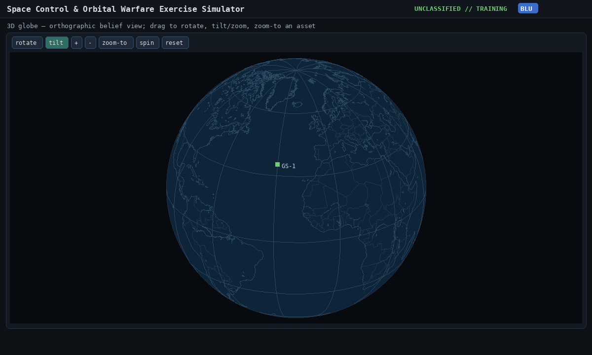

---
