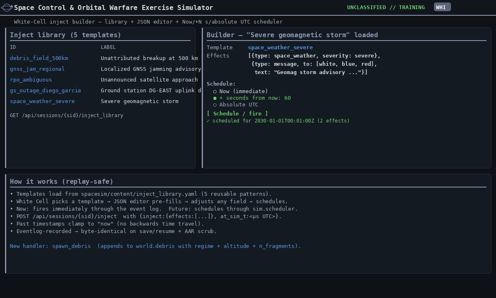

[← Training index](INDEX.md) · [↑ Docs index](../INDEX.md)

## 8. White Cell facilitation

**Hot-seat vs. LAN cooperative.** White can run a session two ways:

- **Hot-seat (single browser):** White loads a vignette and presses Start, then uses the cell
  buttons to switch seats between turns. The ⏸ Handover button blurs the screen between cells.
- **LAN cooperative (multi-tab / multi-machine):** White loads + starts the session, copies the
  URL (`…/#sess-N`), and shares it. Each player opens that URL — same machine in another tab,
  or another LAN box pointed at the host — and picks their cell. The server-authoritative
  clock advances exactly once regardless of tab count. White retains time control: only the
  White tab sees ⏸ Pause / ▶ Resume and the +1m/+10m/+1h jumps.

See [§1.2.1 multi-tab and LAN](01-install-and-run.md#21-multi-tab-and-lan-multiplayer) for the
host-binding command (`--host 0.0.0.0`) and pop-out windows (View ▾ → Pop out).

**Parameters (dials).** Every vignette exposes typed parameters with safe defaults — force levels,
authorities/ROE (e.g. `red_kinetic_authorized`), Red behavior (`red_doctrine_profile`,
`red_ew_intensity`), environment (`landing_window_start_s`), and fidelity/fog (`fog_of_war`,
`ops_fidelity`, `safe_mode_susceptibility`). Set them at load time:

```python
api.load_vignette("leo-isr-denial", overrides={"red_kinetic_authorized": True})
```

**Time control.** White Cell owns the clock: step forward (`+1m/+10m/+1h`), **rewind** to any
point, **undo** the last actions, and **branch** by continuing differently after a rewind — all
byte-exact thanks to the deterministic core.

**Injects.** Scripted or manual events (`commercial_imagery_leak`, `patch_modem`, …) reveal assets,
patch vulnerabilities, raise political consequences, or message a cell. Fire one with the
**Fire inject…** button or `POST /inject`.

**Inject library + builder.** Beyond the per-vignette injects, the White-Cell panel ships a
five-template **library** (`debris_field_500km`, `gnss_jam_regional`, `rpo_ambiguous`,
`gs_outage_diego_garcia`, `space_weather_severe`) and a small builder UI:

1. **Build / schedule inject** disclosure opens an inline form.
2. Pick a template → its effects JSON loads in the editor → adjust any field.
3. Choose schedule: **Now** (immediate), **+ N seconds from now**, or **Absolute UTC**
   (paste-from-UTC-clock).
4. **Schedule / fire** posts to `POST /api/sessions/{sid}/inject` with `at_sim_t` set.

Future-dated injects are scheduled deterministically through the event log — they replay
byte-identical on save/resume and through the AAR scrub. Past timestamps clamp to "now"; no
backwards time travel.



```bash
# Schedule a severe space-weather storm to fire 60 s from now
curl -X POST 'http://127.0.0.1:8000/api/sessions/<SID>/inject?cell=white' -H 'Content-Type: application/json' -d '{
  "inject": {"effects": [
    {"type": "space_weather", "severity": "severe"},
    {"type": "message", "to": ["white","blue","red"], "text": "Geomag storm advisory"}
  ]},
  "at_sim_t": 1893456060000000
}'
```

**Controller events (`FR-4430`).** Four effect types let you script a fault or a move directly.
Paste any of these into the builder's JSON editor (ids from **Training: Basics**; substitute your
vignette's):

```json
[
  {"type": "anomaly", "target": "ISR-EO-1", "subsystem": "bus", "cause": "SEU in flight computer"},
  {"type": "anomaly", "target": "ISR-EO-1", "subsystem": "telemetry", "cause": "transponder fault"},
  {"type": "sensor_outage", "target": "RADAR-TRN", "cause": "power failure"},
  {"type": "forced_custody_loss", "cell": "blue", "target": "RED-TGT", "degrade_to": 0.2},
  {"type": "scripted_manoeuvre", "target": "RED-TGT", "mode": "lvlh", "params": {"dv_t": 2.0}}
]
```

| Type | What it does | Optional keys |
|---|---|---|
| `anomaly`, `subsystem: bus` | Puts the satellite into **safe mode**, so the normal recovery loop applies. Announced to all three cells: `<id>: anomaly declared (<cause>)`. The target must have a bus. | `cause`; `"restore": true` takes it out of safe mode again (`anomaly cleared`). |
| `anomaly`, `subsystem: telemetry` | Sets the satellite's comms to red. Announced to all three cells. | `cause`; `"restore": true` sets comms back to green. |
| `sensor_outage` | Marks the sensor degraded. Announced to all three cells: `<id>: sensor outage declared (<cause>)`. | `cause`; `"restore": true` marks it nominal again (`sensor outage cleared`). |
| `forced_custody_loss` | Sets that cell's track confidence on the target to `degrade_to` (default `0`), and counts the track as last observed at the inject time, so decay starts again from `degrade_to`. No message, so the cell finds out from its track table. The cell must hold the track. | `degrade_to` (a number); `"mode": "drop"` deletes the track instead. |
| `scripted_manoeuvre` | Applies a burn in any of the six manoeuvre modes (`eci`, `lvlh`, `finite_burn`, `target_coe`, `hohmann`, `plane_change`), with that mode's parameters in `params` (for `lvlh`: `dv_r`/`dv_t`/`dv_n`, in m/s). It **bypasses the Δv budget**: nothing is checked or deducted. Only White is told, with the cost. | — |

> **Sources:** `spacesim/session/manager.py` (`_apply_inject_effects`, `_inject_effect_problem`) ·
> `spacesim/engine/maneuver.py` (`compute_maneuver`) · `POST /api/sessions/{sid}/inject`

The library lives at `spacesim/content/inject_library.yaml` — add new entries there and they show
up in the dropdown on next session load.

**Coaching notes.** A vignette can carry an optional `coaching: list[{at_sim_t?, cell, title, body}]`
field. The Coaching sidebar surfaces notes whose target cell matches the active cell (or
`white` = visible to all) and whose `at_sim_t` is in the past. Use these for "discuss this decision
in the AAR" pointers without breaking the player's screen.

**`ops_fidelity`.** `tactical` collapses each satellite's bus to a single health bar (focus on
space-control decisions); `realistic` (default) shows the SOH parameters; `full_ttc` adds detailed
subsystem telemetry for TT&C-operator training.

---
