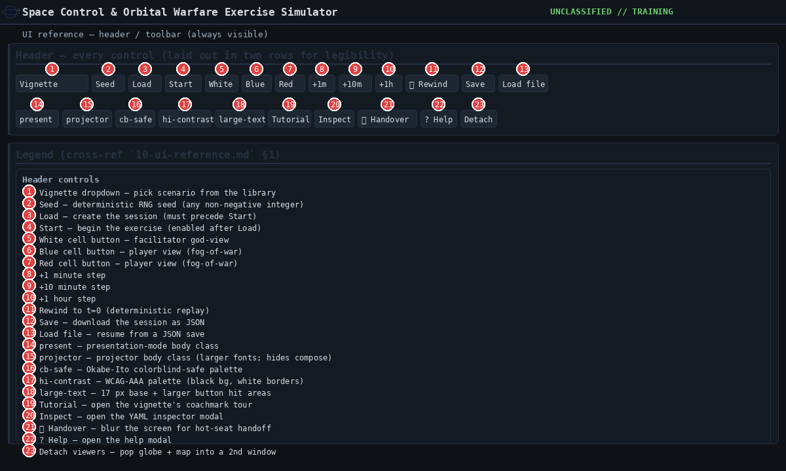
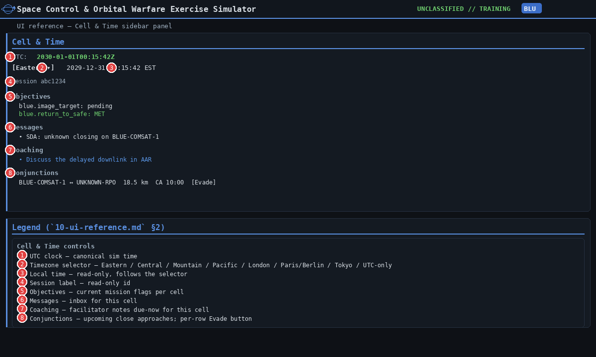
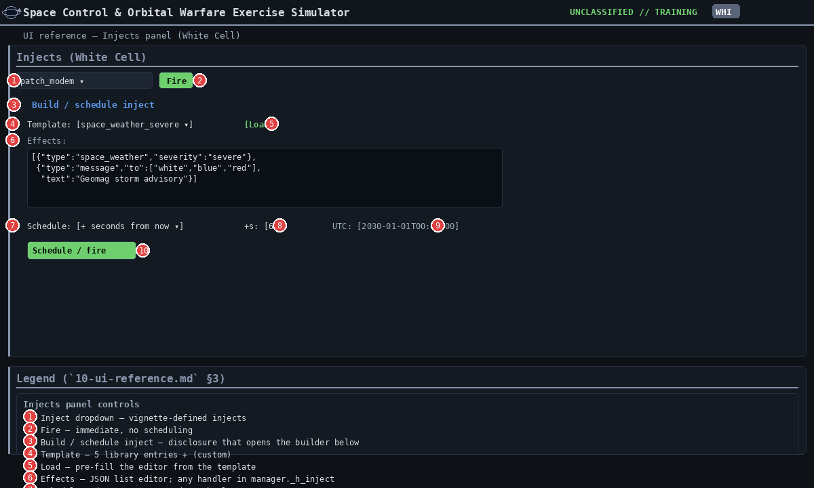
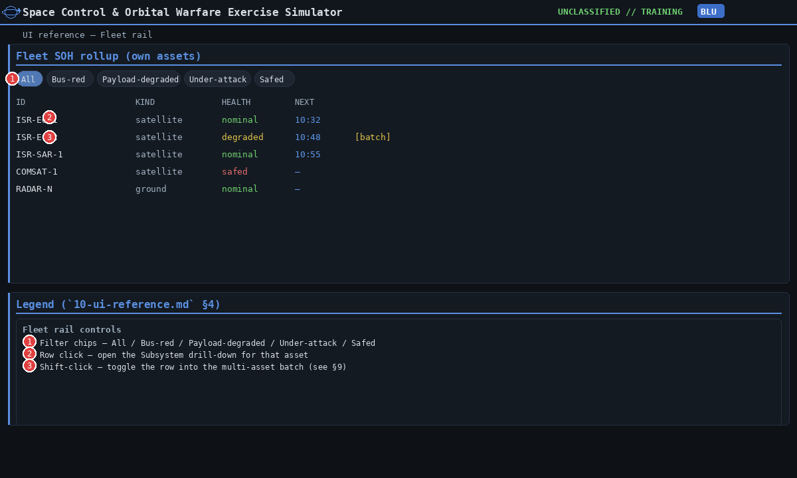

[← Training index](INDEX.md) · [↑ Docs index](../INDEX.md)

## 10. UI reference — every control, dropdown, and input

Exhaustive, scannable list of every interactive element in the web UI. Each section maps 1-for-1
to an annotated screenshot in [`../manual/`](../manual/INDEX.md) — the callout numbers on the
screenshot match the row numbers in each table.

For *narrative* introductions to the same features (when to use them, why they exist), read
[`02-interface.md`](02-interface.md) and [`05-core-concepts.md`](05-core-concepts.md). This
module is the reference.

The reference is split across three modules by panel group, keeping each one readable whole
(NFR-3500). Section numbers are unchanged, so "§10.6" means the same section wherever it is
cited: **this module** holds the always-visible panels (§10.1–§10.4);
[**10a**](10a-ui-reference-orders.md) holds the order panels (§10.5–§10.9);
[**10b**](10b-ui-reference-views.md) holds the viewers and review panels (§10.10–§10.15).

| Section | Panel | Module | Annotated screenshot |
|---|---|---|---|
| §10.1 | Header / toolbar | this module | [`ref-01-header.png`](../manual/ref-01-header.png) |
| §10.2 | Cell & Time sidebar | this module | [`ref-02-cell-time.png`](../manual/ref-02-cell-time.png) |
| §10.3 | Injects (White Cell) + builder | this module | [`ref-03-injects.png`](../manual/ref-03-injects.png) |
| §10.4 | Fleet rail | this module | [`ref-04-fleet.png`](../manual/ref-04-fleet.png) |
| §10.5 | Tasking (sensor) | [10a](10a-ui-reference-orders.md#105-tasking-sensor) | [`ref-05-tasking.png`](../manual/ref-05-tasking.png) |
| §10.6 | Satellite command (compose) | [10a](10a-ui-reference-orders.md#106-satellite-command-compose-form) | [`ref-06-compose.png`](../manual/ref-06-compose.png) |
| §10.7 | Maneuver assistant | [10a](10a-ui-reference-orders.md#107-maneuver-assistant-action--maneuver) | [`ref-07-maneuver.png`](../manual/ref-07-maneuver.png) |
| §10.8 | Jam assistant | [10a](10a-ui-reference-orders.md#108-jam-assistant-action--jam) | [`ref-08-jam.png`](../manual/ref-08-jam.png) |
| §10.9 | Batch bar + fleet-subset helpers | [10a](10a-ui-reference-orders.md#109-batch-bar--fleet-subset-helpers) | [`ref-09-batch.png`](../manual/ref-09-batch.png) |
| §10.10 | 3D globe viewer | [10b](10b-ui-reference-views.md#1010-3d-globe-viewer) | [`ref-10-globe.png`](../manual/ref-10-globe.png) |
| §10.11 | 2D belief map viewer | [10b](10b-ui-reference-views.md#1011-2d-belief-map-viewer) | [`ref-11-map.png`](../manual/ref-11-map.png) |
| §10.12 | After-action review (AAR) | [10b](10b-ui-reference-views.md#1012-after-action-review-aar) | [`ref-12-aar.png`](../manual/ref-12-aar.png) |
| §10.13 | Subsystem drill-down | [10b](10b-ui-reference-views.md#1013-subsystem-drill-down) | [`ref-13-drill.png`](../manual/ref-13-drill.png) |
| §10.14 | Modals, keyboard & mouse | [10b](10b-ui-reference-views.md#1014-modals-overlays-keyboard--mouse) | [`ref-14-modals-keys.png`](../manual/ref-14-modals-keys.png) |
| §10.15 | Cell activity timeline | [10b](10b-ui-reference-views.md#1015-cell-activity-timeline-per-cell-gantt--past--present--scheduled) | [`ref-15-activity.png`](../manual/ref-15-activity.png) |

---

### 10.1 Header / toolbar — always visible

The toolbar is the only persistent UI strip. White-cell-only controls (everything that mutates
the session — Pause/Resume, Rewind, time-step jumps, the Session menu) are hidden when the
operator switches to Blue or Red.

**Toolbar buttons (left to right):**

| # | Control | Type | Effect / valid values |
|---|---|---|---|
| 1 | Logo + title | label | Tints with the active cell accent. |
| 2 | UTC clock | label | Live sim-UTC time (server-authoritative). |
| 3 | Session summary chip | label (white-only) | `<vignette> · <sid> · loaded \| ▶ running` once a session is loaded. |
| 4 | White / Blue / Red | buttons | Switch the operator's seat (client-side `data-cell` swap; fog-of-war is enforced server-side). |
| 5 | ⏸ Pause / ▶ Resume | button (white-only) | `POST /api/sessions/{sid}/clock {running}` — drives the server-authoritative clock for **every** connected tab. |
| 6 | +1m / +10m / +1h | buttons (white-only) | `POST /step` for manual sim-time jumps. Server re-anchors so the wall clock doesn't snap the jump back. |
| 7 | ⟲ Rewind | button (white-only) | `POST /rewind` to t=0. Deterministic replay re-derives state byte-identical; the server re-anchors the clock at the rewound moment. |
| 8 | ⏸ Handover | button | Blur the screen + show "HANDING OFF" overlay (hot-seat seat-swap between cells). |
| 9 | 📋 Session ▾ | menu (white-only) | See §10.1.1 below. |
| 10 | ▦ View ▾ | menu | See §10.1.2 below. |
| 11 | ⚙ Settings ▾ | menu | See §10.1.3 below. |
| 12 | UNCLASSIFIED // TRAINING | banner | Always-visible classification marking. |

The three dropdown menus share the same wiring: click to open, click outside or press
**Esc** to close, opening one closes the others.

#### 10.1.1 Session menu (white-only)

| Section | Item | Effect |
|---|---|---|
| Vignette | Vignette dropdown | Pick a scenario from the library before Load. |
| Vignette | Seed input | Deterministic RNG seed (any non-negative integer; default 1). |
| Vignette | **Load** button | `POST /api/sessions` → creates the session id. The page URL gets `#sess-N` appended so it can be shared. |
| Vignette | **▶ Start** button | `POST /api/sessions/{sid}/start` + arms the server clock. Disabled until Load. |

#### 10.1.2 View menu

| Section | Item | Effect |
|---|---|---|
| Display mode | Presentation mode | Body class `present` (hides facilitator controls during demo). |
| Display mode | Projector mode | Body class `projector` (larger fonts, hides compose form for a White-Cell projector). |
| Display mode | Color-blind safe | Body class `cb` (Okabe-Ito palette). |
| Display mode | High contrast | Body class `hi-contrast` (WCAG-AAA palette). |
| Display mode | Large text | Body class `large-text` (17 px base + larger hit areas). |
| Pop out (multi-screen) | 3D globe | Open `/?layout=globe&cell=<current>#<sid>` in a new window — that window joins the same session and shows only the 3D globe panel. |
| Pop out | 2D belief map | Same pattern with `layout=map`. |
| Pop out | Globe + Map | `layout=globe+map` (both viewers side-by-side). |
| Pop out | Fleet & telemetry | `layout=fleet` — fleet rail + drill-down. |
| Pop out | Order compose | `layout=order` — compose form + activity timeline. |
| Pop out | AAR timeline | `layout=aar` — AAR scrubber. |

Pop-out windows reuse the polished panels — there is no separate "viewer" surface. Each
pop-out polls the server at 1.5 s like any other tab, so closing the parent doesn't kill them.

#### 10.1.3 Settings menu

| Section | Item | Effect |
|---|---|---|
| Session | ⬇ Save session | `GET /save` → download session JSON. |
| Session | ⬆ Load session | File picker + `POST /load_save` (the loaded session starts paused — White must Resume). A save that cannot be used is refused with a reason (HTTP 400), including a legacy save whose vignette file is no longer available. |
| Tools | ? Coachmark tour | Walk the UI itself with a spotlight tip. |
| Tools | Tutorial panel | Per-vignette tutorial steps for the active cell. |
| Tools | Inspect vignette YAML | Open the vignette YAML inspector modal. |
| Tools | ? Help | Open the help modal (shortcuts + glossary + workflow tips). |

> **Sources:** `spacesim/ui_web/static/index.html` (toolbar, Session / View / Settings menus) · `spacesim/ui_web/static/app.js` (`loadSession`, `setServerClock`, `stepBy`, `rewindTo`, `popOut`, `LAYOUT_PANELS`, `saveSession`, `loadSaveFile`, `coachOpen`, `tutorialOpen`, `inspectorOpen`) · `spacesim/ui_web/server.py` (`/clock`, `/start`, `/step`, `/rewind`, `/save`, `/load_save`)

---

### 10.2 Cell & Time — sidebar panel (top)

| # | Control | Type | Effect / valid values |
|---|---|---|---|
| 1 | UTC | read-only | Canonical sim time (`iso(NOW)` from the engine, always UTC). |
| 2 | Timezone selector | dropdown | Eastern (default) / Central / Mountain / Pacific / London / Paris/Berlin / Tokyo / UTC-only. |
| 3 | Local time | read-only | Renders NOW in the selected zone via `Intl.DateTimeFormat`. |
| 4 | Session label | read-only | The active session id. |
| 5 | Objectives | read-only color-coded list | Per-cell mission objectives, one row each. `✓` (green, bright text, green left-border) when met; `✗` (red mark, dim text, red left-border) when unmet. Blue/Red see only their own side (fog-of-war); White sees both sides with `blue` / `red` group labels. Object ids are prettified (`deliver_isr` → "Deliver ISR"). |
| 6 | Messages | read-only `<ul>` | Inbox for this cell (sorted newest first). |
| 7 | Coaching | read-only list | `GET /coaching/{cell}` — facilitator notes due-now for this cell. |
| 8 | Conjunctions | list + Evade buttons | `GET /conjunctions/{cell}` — each row carries a per-asset Evade button. |

The **Evade** button on a conjunction row issues a `command` order with `verb: prop.collision_avoid`
on the own asset, queued to the next command-uplink window.

> **Sources:** `spacesim/ui_web/static/app.js` (`localTimeStr`, `renderObjectives`, `prettyObjectiveId`, `renderCoaching`, `renderConjunctions`) · `spacesim/ui_web/server.py` (`/coaching/{cell}`, `/conjunctions/{cell}`)

---

### 10.3 Injects (White Cell) + Build / schedule inject

| # | Control | Type | Effect / valid values |
|---|---|---|---|
| 1 | Inject dropdown | dropdown | Vignette-defined injects from `GET /injects`. |
| 2 | Fire | button | `POST /inject` with `{inject: <id>}` — fires immediately. If the server rejects the inject (HTTP 400, see below), nothing is applied and **nothing appears on screen**: this button has no result line. If an expected message never shows in **Messages**, re-check the inject in the builder, which does report the reason. |
| 3 | Build / schedule inject | `
` toggle | Expands the builder panel below. |
| 4 | Template | dropdown | 5 library entries from `GET /inject_library` + `(custom)`. |
| 5 | Load | button | Pre-fills the JSON editor with the selected template's effects. |
| 6 | Effects | textarea | JSON list. Any `type` recognised by `manager._h_inject` (see below). |
| 7 | Schedule | dropdown | **Now** (immediate) / **+ seconds from now** / **Absolute UTC**. |
| 8 | + seconds from now | number | Visible only when Schedule=+s. Offset in seconds. |
| 9 | Absolute UTC | datetime-local | Visible only when Schedule=absolute. UTC literal (paste from the UTC clock). |
| 10 | Schedule / fire | button | `POST /inject` with `{inject:{effects:[…]}, at_sim_t:<µs>}`. Past timestamps clamp to "now". |
| 11 | Result line | read-only | `✓ fired immediately (N effects)` or `✓ scheduled for <UTC> (N effects)` on success. A rejected inject shows `✗ server error:` followed by the server's `inject rejected: #i <type>: <reason>` text, one entry per bad effect (`#i` is the effect's position, counting from 0). |

**Supported effect types in the editor:** `message`, `reveal_asset`, `political_consequence`,
`patch_cyber_vuln`, `gs_outage`, `space_weather`, `conjunction_warning`, `spawn_debris`, plus the
four controller events `anomaly` (needs `target` and `subsystem`: `bus` or `telemetry`),
`sensor_outage` (`target` = a sensor id), `forced_custody_loss` (`cell` = `blue`/`red` and
`target`) and `scripted_manoeuvre` (`target`, `mode` = one of the six manoeuvre modes, `params`).
See [`07-white-cell-facilitation.md`](07-white-cell-facilitation.md) for example payloads.

**Checked before anything fires.** The server checks the whole effect list when you click Fire or
Schedule / fire. It rejects the inject with HTTP 400, and applies **none** of its effects (even the
valid ones), when any effect:

- has an unknown `type`, is missing a required key, or has a malformed value (for example an
  `anomaly` subsystem other than `bus`/`telemetry`);
- is an `anomaly` whose target has no bus (for example, any shipped Red satellite);
- is a `sensor_outage` whose target is not a sensor;
- is a `forced_custody_loss` for a track that cell does not hold;
- is a `scripted_manoeuvre` whose target has no orbit, or whose `params` the manoeuvre maths refuses.

The same check runs when you fire a vignette inject by name with **Fire** (row 2).

A builder inject you schedule for later goes through the same check when you click Schedule /
fire. It is **not checked again when it fires**, so its targets may have changed by then.

Injects a vignette schedules by time or by condition are never checked at the console, because
they fire on their own. When one of these fires:

- a malformed effect is skipped, the rest still apply, and White alone gets the **Messages** line
  `inject effect skipped (<type>): <reason>`.

When any scheduled inject fires, vignette or builder:

- a well-formed effect whose target is missing or unsuitable at that moment (for example, the
  track is gone, or the satellite no longer has a bus) is skipped with **no** message;
- a `scripted_manoeuvre` whose `params` the manoeuvre maths now refuses is skipped with the same
  White-only `inject effect skipped` line.

> **Sources:** `spacesim/ui_web/static/app.js` (`fireInject`, `loadInjectLibrary`, `loadInjectTemplate`, `injectScheduleAt`, `fireBuiltInject`) · `spacesim/session/manager.py` (`_h_inject`) · `spacesim/content/inject_library.yaml` · `spacesim/ui_web/server.py` (`/inject`, `/inject_library`, `/injects`)

---

### 10.4 Fleet rail

| # | Control | Type | Effect / valid values |
|---|---|---|---|
| 1 | Filter chips | 5 chips | **All** / **Bus-red** / **Payload-degraded** / **Under-attack** / **Safed** — filters the table client-side. |
| 2 | Row click | mouse | Opens the Subsystem drill-down for that asset. |
| 3 | Row shift+click | mouse | Toggles the row into the multi-asset batch (see [§10.9](10a-ui-reference-orders.md#109-batch-bar--fleet-subset-helpers)). |

The next-contact countdown column is **read-only** (data from `GET /next_contacts/{cell}`).

> **Sources:** `spacesim/ui_web/static/app.js` (`renderFleet`, `fleetPasses`, `BATCH`) · `spacesim/ui_web/server.py` (`/next_contacts/{cell}`)

---

---

### Cross-references

- **HTTP endpoints behind each control:** [`08-http-api-reference.md`](08-http-api-reference.md).
- **Why each panel exists (narrative):** [`02-interface.md`](02-interface.md), [`05-core-concepts.md`](05-core-concepts.md).
- **White-Cell facilitation patterns:** [`07-white-cell-facilitation.md`](07-white-cell-facilitation.md).
- **Build-spec operator-console contract:** [`../build-spec/07-operator-console.md`](../build-spec/07-operator-console.md).

---
