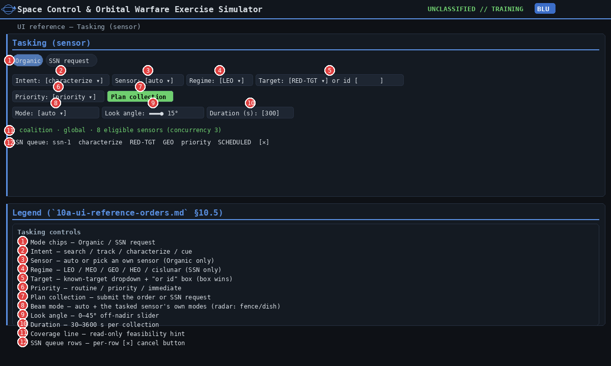
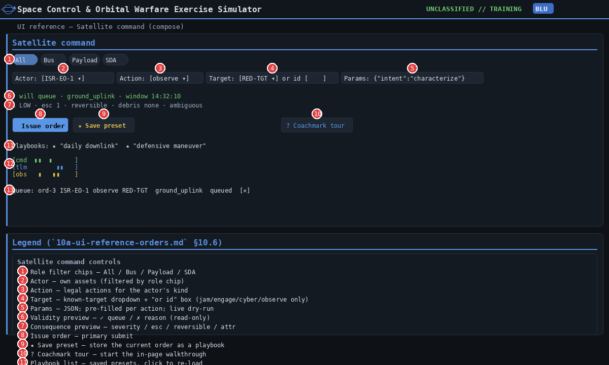
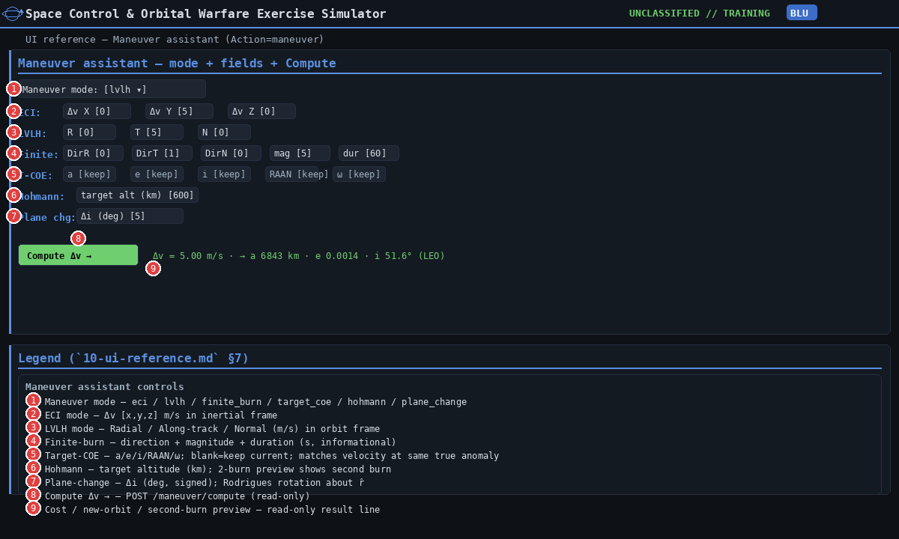
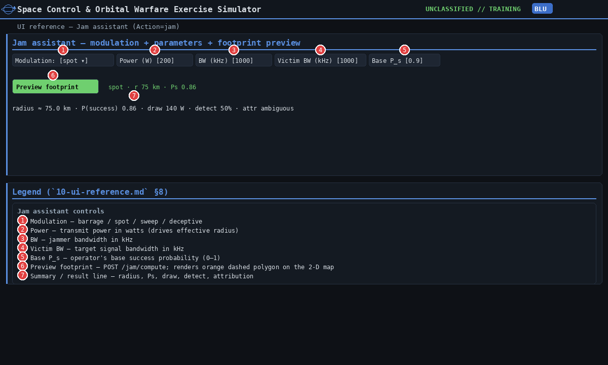
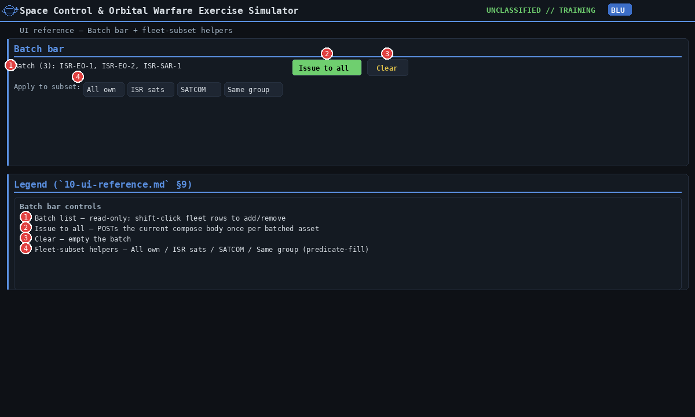

[← Training index](INDEX.md) · [↑ Docs index](../INDEX.md) · [§10 UI reference](10-ui-reference.md)

## 10a. UI reference — order panels (§10.5–§10.9)

Part of the [§10 UI reference](10-ui-reference.md): the sensor-tasking panel, the satellite
command compose form and its maneuver/jam assistants, and the batch bar. The always-visible
panels (§10.1–§10.4) are in [10](10-ui-reference.md); the viewers and review panels (§10.10–§10.15)
are in [10b](10b-ui-reference-views.md).

---

### 10.5 Tasking (sensor)

| # | Control | Type | Effect / valid values |
|---|---|---|---|
| 1 | Mode chips | 2 chips | **Organic** (own sensor) / **SSN request** (national/coalition SSN). |
| 2 | Intent | dropdown | **search** / **track** / **characterize** / **cue**. |
| 3 | Sensor | dropdown | Organic mode only. `auto` lets the engine pick the earliest viable own sensor. |
| 4 | Regime | dropdown | SSN mode only. **LEO** / **MEO** / **GEO** / **HEO** / **cislunar**. |
| 5 | Target | dropdown + **or id** text input | Dropdown lists the other side's **known targets**: your tracks, grouped by owner, plus any non-own satellite/space-based/interceptor/directed-energy asset your fog-filtered view shows. White tasks on Blue's behalf and so sees every non-Blue asset. When the list is empty it says *no known targets yet*. The **or id** box takes precedence over the dropdown. Use it to task a sensor against an id you have not tracked yet; collection is how custody starts. If both are empty, Plan collection falls back to the compose form's target (§10.6 row 4). |
| 6 | Priority | dropdown | **routine** / **priority** / **immediate** (drives SSN SLA + organic queue order). |
| 7 | Plan collection | button | Organic: `POST /order` with `action: observe`. SSN: `POST /ssn/{cell}/request`. |
| 8 | Mode | dropdown (beam mode) | `auto` + **wide_area / stripmap / spotlight / scan / fine / polarimetric** (see `engine/isr.py`). On a ground radar keep `auto`: any other entry replaces the radar's own `fence`/`dish` mode. The radar modes are not listed here; send them through §10.6 row 5 (see [`06`](06-the-vignette-library.md#authoring-sensors-optional-modality-fields)). |
| 9 | Look angle | range slider | 0–45° off-nadir. Cosine roll-off applies to gain + swath width. |
| 10 | Duration (s) | number | 30–3600 s. Drives the SOC drain `base × power_factor × duration / 300`. |
| 11 | Coverage line | read-only | SSN mode: `GET /ssn/{cell}/coverage?regime=` — feasibility hint. |
| 12 | SSN queue rows | per-row [✕] cancel | `POST /ssn/{cell}/cancel`. |

> **Sources:** `spacesim/ui_web/static/app.js` (`setTaskMode`, `planTask`, `ssnCoverage`, `renderSsnQueue`, `populateTargetPicker`, `ISR_BEAM_INFO`) · `spacesim/ui_web/static/index.html` (`task-beam-mode`) · `spacesim/engine/isr.py` (`BEAM_MODES`) · `spacesim/ui_web/server.py` (`/order`, `/ssn/{cell}/request`, `/ssn/{cell}/coverage`, `/ssn/{cell}/cancel`)

---

### 10.6 Satellite command (compose form)

| # | Control | Type | Effect / valid values |
|---|---|---|---|
| 1 | Role filter chips | 4 chips | **All** / **Bus** / **Payload** / **SDA** — filters the Actor dropdown. |
| 2 | Actor | dropdown | Own assets (filtered by role chip + current cell). |
| 3 | Action | dropdown | Legal actions for the actor's `kind`: e.g. satellite ⇒ `downlink/maneuver/command`, jammer ⇒ `jam`. |
| 4 | Target | dropdown + **or id** text input | Uses the same known-target list as §10.5 row 5, with the selected actor's own side left out. The **or id** box takes precedence. Both fields are **enabled only for `jam` / `engage` / `cyber` / `observe`**. For any other action they are blanked and disabled because that order takes no target. |
| 5 | Params | JSON text, under **Advanced (raw JSON params)** | Pre-filled per action (see PARAM_TEMPLATE in `app.js`). Live dry-run on every keystroke. A field with the wrong type or a non-finite number (`"inf"`, a `dv` without exactly three numbers) shows ✗ `invalid_param`. A field set to `null` counts as left out. |
| 6 | Validity preview | read-only | ✓ queue · delivery_path · window OR ✗ reason (from `POST /order/validate`). |
| 7 | Consequence preview | read-only | severity / esc / reversible / debris / attribution (from `POST /preview/consequence`). |
| 8 | Issue order | primary button | `POST /order`. Disabled while validity preview is ✗. |
| 9 | ★ Save preset | button | Save the current order as a named playbook (`localStorage`, per vignette). |
| 10 | ? Coachmark tour | button | Start the in-page coachmark tour over compose form. |
| 11 | Playbook list | clickable rows | Click to load a saved preset back into the form. |
| 12 | Pass-timeline ribbon | read-only canvas | Three lanes (**cmd / tlm / obs**) for the selected actor, next 6 h. Hourly tick marks. |
| 13 | Queue rows | per-row [✕] cancel | `POST /cancel` (replay-safe — Scheduler skips the cancelled event). |

When **Action** is set to `maneuver` or `jam`, an additional assistant panel appears below
Params — see §10.7 / §10.8 below.

*Screenshot note:* `ref-05-tasking.png` and `ref-06-compose.png` were drawn before the target
picker shipped and still show **Target** as a single text box. Where a screenshot and a table row
disagree, follow the table row (§10.5 row 5, §10.6 row 4).

> **Sources:** `spacesim/ui_web/static/app.js` (`ACTIONS_BY_KIND`, `TARGET_REQUIRED_ACTIONS`, `PARAM_TEMPLATE`, `composeBody`, `previewOrder`, `renderConsequencePreview`, `issueOrder`, `pbSave`, `renderPlaybooks`, `drawRibbon`, `renderQueue`) · `spacesim/ui_web/server.py` (`/order`, `/order/validate`, `/preview/consequence`, `/cancel`)

---

### 10.7 Maneuver assistant (Action = maneuver)

| # | Control | Type | Effect / valid values |
|---|---|---|---|
| 1 | Maneuver mode | dropdown | **eci / lvlh / finite_burn / target_coe / hohmann / plane_change**. Switches the field set. |
| 2 | ECI Δv X / Y / Z | numbers | (mode=eci) m/s in the inertial frame. |
| 3 | LVLH R / T / N | numbers | (mode=lvlh) Radial / Along-track / Normal m/s in the orbit frame. |
| 4 | Finite-burn DirR/T/N + mag + dur | numbers | (mode=finite_burn) direction (normalised LVLH) + magnitude (m/s) + duration (s; informational). |
| 5 | Target-COE a / e / i / RAAN / ω | numbers | (mode=target_coe) blank = keep current. Matches velocity at same true anomaly. |
| 6 | Hohmann target altitude | number | (mode=hohmann) km. Two-burn transfer; second-burn line appears in result. |
| 7 | Plane-change Δi | number | (mode=plane_change) signed degrees. Rodrigues rotation about r̂. |
| 8 | Compute Δv → | button | `POST /maneuver/compute` — read-only preview. |
| 9 | Cost / new-orbit line | read-only | `Δv = <m/s>` · `new_orbit a/e/i…` · optional `second_burn`. Result also fills `o-params`. |

Click **Compute** then **Issue order** to queue the maneuver; the engine consumes Δv from the
asset's `resources.delta_v_ms` when the order executes at its window.

> **Sources:** `spacesim/ui_web/static/app.js` (`mnvrModeChange`, `mnvrGatherParams`, `computeManeuver`) · `spacesim/engine/maneuver.py` · `spacesim/ui_web/server.py` (`/maneuver/compute`)

---

### 10.8 Jam assistant (Action = jam)

| # | Control | Type | Effect / valid values |
|---|---|---|---|
| 1 | Modulation | dropdown | **barrage / spot / sweep / deceptive**. `deceptive` auto-overrides attribution to `overt`. |
| 2 | Power (W) | number | Transmit power. Drives the effective denial radius (`R ∝ √P`). |
| 3 | BW (kHz) | number | Jammer bandwidth. |
| 4 | Victim BW (kHz) | number | Target signal bandwidth (drives coverage weighting for sweep/spot). |
| 5 | Base P_s | number | Operator's base success probability (0–1). |
| 6 | Preview footprint | button | `POST /jam/compute`. Renders an orange dashed polygon on the 2-D map. |
| 7 | Summary / result line | read-only | `radius ≈ <km> · P(success) 
 · draw <W> · detect <%> · attr <bias>`. |

The preview polygon stays on the map until the operator changes the Action away from `jam`.

> **Sources:** `spacesim/ui_web/static/app.js` (`jamGatherParams`, `jamSummaryUpdate`, `computeJam`) · `spacesim/engine/jam.py` (`effective_radius_km`) · `spacesim/ui_web/server.py` (`/jam/compute`)

---

### 10.9 Batch bar + fleet-subset helpers

| # | Control | Type | Effect / valid values |
|---|---|---|---|
| 1 | Batch list | read-only | Comma-separated asset ids currently in the batch. |
| 2 | Issue to all | button | POSTs the current compose body once per batched asset. |
| 3 | Clear | button | Empty the batch. |
| 4 | Fleet-subset helpers | 4 buttons | **All own / ISR sats / SATCOM / Same group** — predicate-fill the batch. |

The **Same group** helper requires an Actor already selected and uses its `group` field.

> **Sources:** `spacesim/ui_web/static/app.js` (`BATCH`, `batchRender`)

---

---

### Cross-references

- **HTTP endpoints behind each control:** [`08-http-api-reference.md`](08-http-api-reference.md).
- **Why each panel exists (narrative):** [`02-interface.md`](02-interface.md), [`05-core-concepts.md`](05-core-concepts.md).
- **White-Cell facilitation patterns:** [`07-white-cell-facilitation.md`](07-white-cell-facilitation.md).
- **Build-spec operator-console contract:** [`../build-spec/07-operator-console.md`](../build-spec/07-operator-console.md).

---
