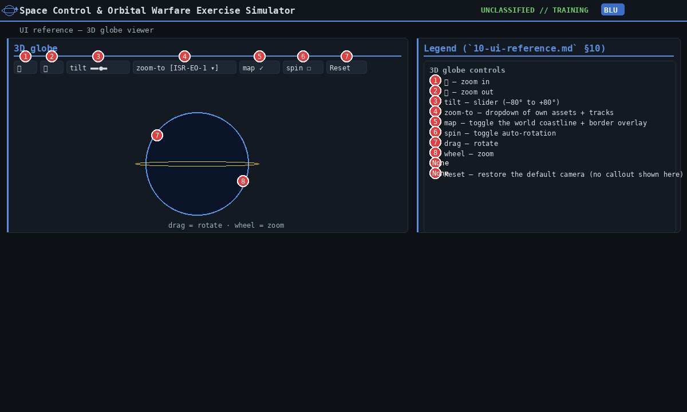
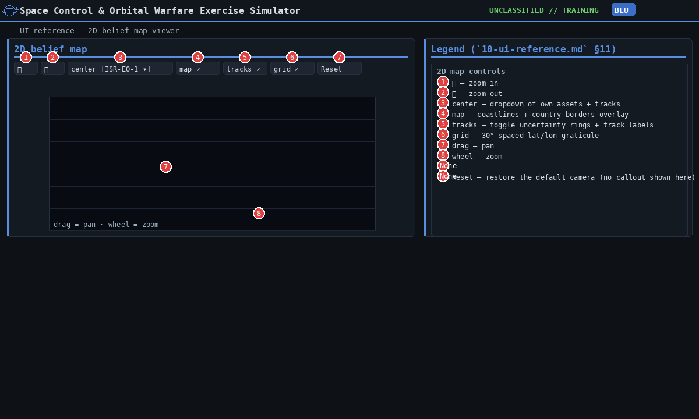
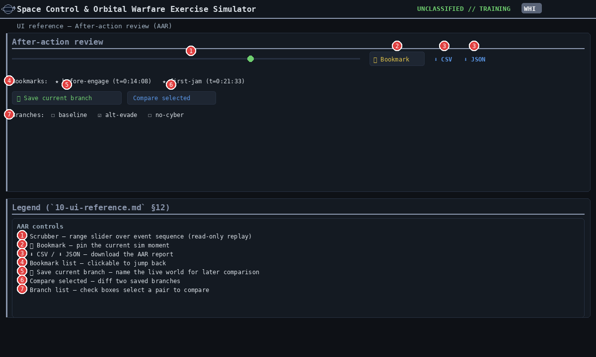
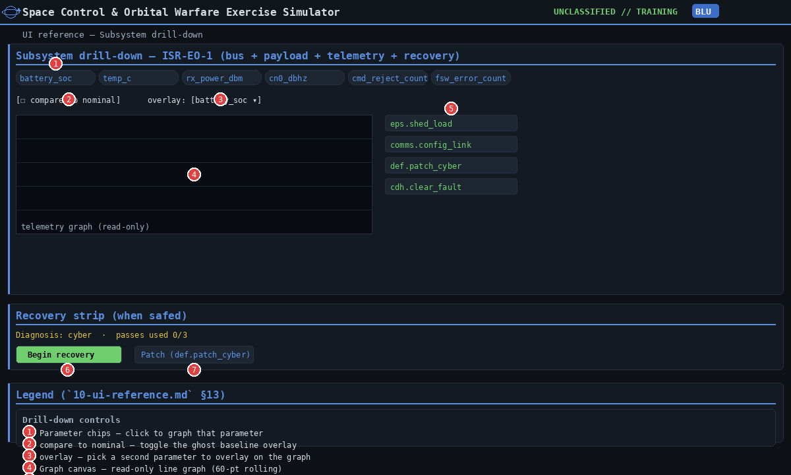
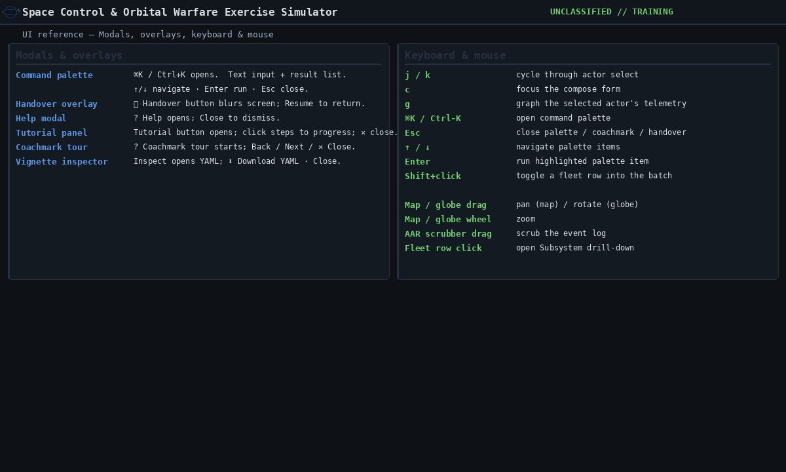
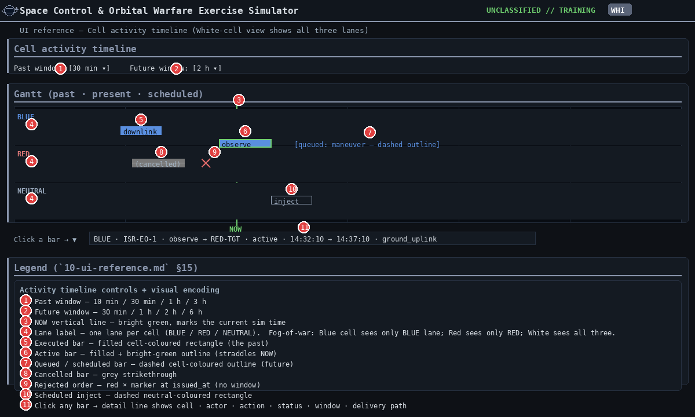

[← Training index](INDEX.md) · [↑ Docs index](../INDEX.md) · [§10 UI reference](10-ui-reference.md)

## 10b. UI reference — viewers and review panels (§10.10–§10.15)

Part of the [§10 UI reference](10-ui-reference.md): the 3D globe and 2D map, the after-action
review, the subsystem drill-down, modals and input shortcuts, and the activity timeline. The
always-visible panels (§10.1–§10.4) are in [10](10-ui-reference.md); the order panels
(§10.5–§10.9) are in [10a](10a-ui-reference-orders.md).

---

### 10.10 3D globe viewer



| # | Control | Type | Effect / valid values |
|---|---|---|---|
| 1 | ＋ | button | Zoom in. |
| 2 | － | button | Zoom out. |
| 3 | tilt | range slider | –80° to +80°. |
| 4 | zoom-to | dropdown | Own assets + tracks; selecting an entry centres the camera. |
| 5 | map | checkbox | Toggle world coastlines + country borders. |
| 6 | spin | checkbox | Auto-rotate. |
| 7 | Canvas drag | mouse | Rotate the globe. |
| 8 | Canvas wheel | mouse | Zoom in/out. |
| — | Reset | button | Restore the default camera (no callout shown). |

> **Sources:** `spacesim/ui_web/static/globe.js`

---

### 10.11 2D belief map viewer



| # | Control | Type | Effect / valid values |
|---|---|---|---|
| 1 | ＋ | button | Zoom in. |
| 2 | － | button | Zoom out. |
| 3 | center | dropdown | Own assets + tracks; selecting centres the map on the asset. |
| 4 | map | checkbox | Toggle world coastlines + country borders. |
| 5 | tracks | checkbox | Toggle uncertainty rings + track labels. |
| 6 | grid | checkbox | Toggle the 30°-spaced lat/lon graticule. |
| 7 | Canvas drag | mouse | Pan the map (lat/lon offset). |
| 8 | Canvas wheel | mouse | Zoom in/out. |
| — | Reset | button | Restore the default camera (no callout shown). |

> **Sources:** `spacesim/ui_web/static/app.js` (`drawMap`, `initMapControls`) · `spacesim/ui_web/static/world.js`

---

### 10.12 After-action review (AAR)



| # | Control | Type | Effect / valid values |
|---|---|---|---|
| 1 | Scrubber | range slider | 0 → `n_events`. Read-only replay; never disturbs the live session. |
| 2 | 📌 Bookmark | button | Pin the current sim moment to revisit later. |
| 3 | ⬇ CSV / ⬇ JSON | download links | `GET /aar/export.csv` / `GET /aar/export.json`. |
| 4 | Bookmark list | clickable rows | Click to jump the scrubber back to the bookmarked moment. |
| 5 | ＋ Save current branch | button | Name the live world for later comparison. |
| 6 | Compare selected | button | Diff two saved branches (objectives + assets). |
| 7 | Branch list | checkbox rows | Select up to two branches for the compare. |

> **Sources:** `spacesim/ui_web/static/app.js` (`refreshAAR`, `aarAt`, `bmSave`, `renderBookmarks`, `brSave`, `renderBranches`, `compareBranches`, `refreshAarLinks`) · `spacesim/session/aar.py` (`compare_branches`) · `spacesim/ui_web/server.py` (`/aar/export.csv`, `/aar/export.json`)

---

### 10.13 Subsystem drill-down



| # | Control | Type | Effect / valid values |
|---|---|---|---|
| 1 | Orbital elements | read-only strip | a / e / i / Ω / ω / ν + period for the selected satellite, from the scene; refreshes on every poll so a maneuver's new orbit shows within ~1.5 s. Hidden for ground assets. |
| 2 | Parameter chips | clickable chips | Click to graph that telemetry parameter. |
| 3 | compare to nominal | checkbox | Overlay the clean baseline (`?nominal=1`). |
| 4 | overlay | dropdown | Pick a second parameter to overlay on the graph. |
| 5 | Graph canvas | read-only | 120-point line graph of the last hour of sim time (or since exercise start) from `GET /telemetry/{cell}/{asset}/{param}?n=120`; each point is that instant's own state. |
| 6 | Verb buttons | per-subsystem cards | One-click load the command verb into the compose form. |
| 7 | Begin recovery | button | (Recovery strip) `POST /recovery/{cell}/{asset}` — start the multi-pass chain. |
| 8 | Patch (def.patch_cyber) | button | (Recovery strip) Load the patch-cyber command pre-filled with the first unpatched vector. |

The recovery strip appears only when the selected asset's bus is in safe mode. The subsystem
log under the graph is read-only.

> **Sources:** `spacesim/ui_web/static/app.js` (`openDrill`, `renderOrbitalElements`, `drawParam`, `verbsForSubsystem`, `loadVerb`, `renderRecovery`) · `spacesim/ui_web/static/graph.js` · `spacesim/engine/telemetry.py` · `spacesim/ui_web/server.py` (`/telemetry/{cell}/{asset}/{param}`, `/recovery/{cell}/{asset}`)

---

### 10.14 Modals, overlays, keyboard & mouse



#### Modals & overlays

| Modal | Trigger | Controls |
|---|---|---|
| Command palette | `⌘K` / `Ctrl+K` | text input · result list · `↑/↓` navigate · `Enter` run · `Esc` close |
| Handover | ⏸ Handover button | **Resume** button |
| Help | ? Help button | **Close** button |
| Tutorial | Tutorial button | **✕** close · clickable steps |
| Coachmark tour | ? Coachmark tour button | **← Back** · **Next →** · **✕ Close** |
| Vignette inspector | Inspect button | **⬇ Download YAML** · **Close** |

#### Keyboard shortcuts (global)

| Key | Effect |
|---|---|
| `j` / `k` | Cycle through actor select |
| `c` | Focus the compose form |
| `g` | Open Subsystem drill-down for the selected actor |
| `⌘K` / `Ctrl+K` | Open the command palette |
| `Esc` | Close palette / coachmark / handover |
| `↑` / `↓` | Navigate palette items |
| `Enter` | Run the highlighted palette item |
| `Shift+click` on fleet row | Toggle the row into the batch |

#### Mouse / canvas interactions

| Where | Action |
|---|---|
| 2D map canvas | Drag = pan · wheel = zoom |
| 3D globe canvas | Drag = rotate · wheel = zoom |
| AAR scrubber | Drag the slider thumb to scrub event-by-event |
| Fleet row | Click = open drill-down · shift+click = batch toggle |

> **Sources:** `spacesim/ui_web/static/app.js` (`onShortcut`, `PALETTE`, `paletteOpen`, `COACH_STEPS`, `coachOpen`, `tutorialOpen`, `inspectorOpen`) · `spacesim/ui_web/static/index.html` (`handover`)

---

### 10.15 Cell activity timeline (per-cell Gantt — past · present · scheduled)



Each cell gets a Gantt-style ribbon showing what *that* cell has done, is doing, and has
scheduled. **Fog-of-war applies at the API boundary:**

- **White Cell** sees three lanes: BLUE, RED, NEUTRAL — every order, every active effect,
  every scheduled inject.
- **Blue Cell** sees only the BLUE lane — only its own orders and effects on its own assets.
- **Red Cell** sees only the RED lane — same fog-of-war contract.

The data feed is `GET /api/sessions/{sid}/activity/{cell}` — read-only, replay-safe, derived
from `osys.orders`, `world.active_effects`, and `sim.scheduler.pending()`.

| # | Control | Type | Effect / valid values |
|---|---|---|---|
| 1 | Past window | dropdown | **10 min / 30 min / 1 h / 3 h** — how far back to show. |
| 2 | Future window | dropdown | **30 min / 1 h / 2 h / 6 h** — how far ahead to show. |
| 3 | NOW vertical line | read-only | Bright-green line at the current sim time. |
| 4 | Lane label | read-only | One lane per visible cell (BLUE / RED / NEUTRAL for White; single lane for Blue or Red). |
| 5 | Executed bar | read-only | Filled cell-coloured rectangle, meant for an order that completed. As built it does not appear: a past order keeps its dashed **queued** outline (row 7; `BL-0266`). |
| 6 | Active bar | read-only | Filled + bright-green outline. The order's window straddles NOW (currently executing). |
| 7 | Queued / scheduled bar | read-only | Dashed cell-coloured outline. The order is waiting for its window, or (as built) its window has already passed. Check the order queue ([§10.6](10a-ui-reference-orders.md#106-satellite-command-compose-form) row 13) to see whether it has executed. |
| 8 | Cancelled bar | read-only | Grey strikethrough. The order was cancelled before firing. |
| 9 | Rejected marker | read-only | Red **×**. The order was rejected at issue (no window). |
| 10 | Scheduled inject | read-only | Dashed neutral-coloured rectangle at the inject's `at_sim_t`. |
| 11 | Bar click | mouse | Shows `cell · actor · action · status · window · delivery_path` in the detail line below. |

Bars within a lane are stacked vertically per **actor** (asset id) so a single satellite's
activity reads as one row; multiple satellites stack within the same cell lane.

**Status semantics (engine source of truth):**

| Status | Meaning | Source |
|---|---|---|
| `executed` | Order has fired. **As built this status is never sent** (`Order.status` holds only `queued`/`cancelled`/`rejected`), so a past order's bar still draws as **queued** (dashed). Filed as a code bug, `BL-0266`. | `osys.orders` |
| `active` | The bar's window contains NOW | computed at request time |
| `queued` | Order has a future window but has not fired yet | `osys.orders` |
| `cancelled` | Cancelled before firing (`POST /cancel`) | `osys.orders` |
| `rejected` | Rejected at issue (`Order.status == "rejected"`) | `osys.orders` |
| `scheduled` | Future inject in `sim.scheduler.pending()` | scheduler |

**Endpoint:** `GET /api/sessions/{sid}/activity/{cell}?past_window_s=<int>&future_window_s=<int>`
returns
```json
{
  "now": <µs UTC>,
  "t_start": <µs UTC>, "t_end": <µs UTC>,
  "cells": ["blue", "red", "neutral"],
  "activities": [
    {"kind": "order"|"inject"|"effect", "cell": "blue"|"red"|"neutral",
     "actor": "<asset id>", "action": "<verb>", "target": "<id>|null",
     "start": <µs>, "end": <µs>, "status": "...", "label": "...",
     "delivery_path": "<path>|null"}
  ]
}
```

> **Sources:** `spacesim/ui_web/static/app.js` (`renderActivity`, `drawActivityGantt`, `drawActivityBar`) · `spacesim/session/inprocess.py` (`cell_activity`) · `spacesim/ui_web/server.py` (`/activity/{cell}`)

---

---

### Cross-references

- **HTTP endpoints behind each control:** [`08-http-api-reference.md`](08-http-api-reference.md).
- **Why each panel exists (narrative):** [`02-interface.md`](02-interface.md), [`05-core-concepts.md`](05-core-concepts.md).
- **White-Cell facilitation patterns:** [`07-white-cell-facilitation.md`](07-white-cell-facilitation.md).
- **Build-spec operator-console contract:** [`../build-spec/07-operator-console.md`](../build-spec/07-operator-console.md).

---
